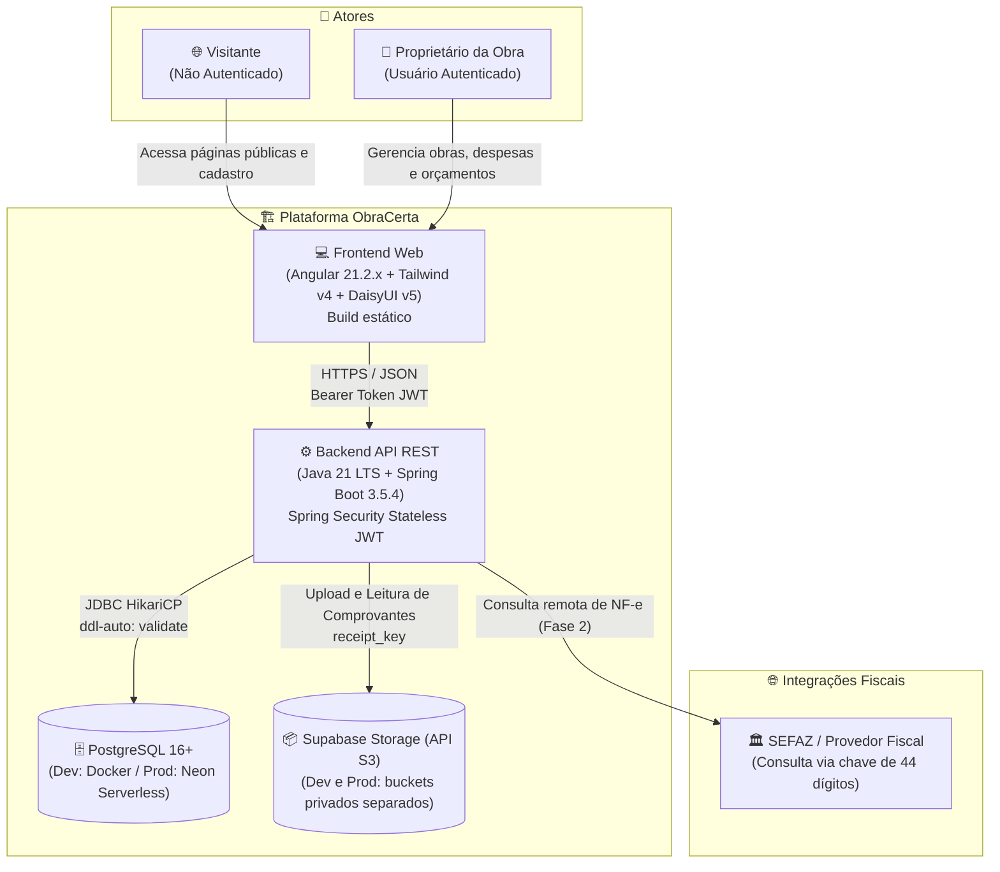
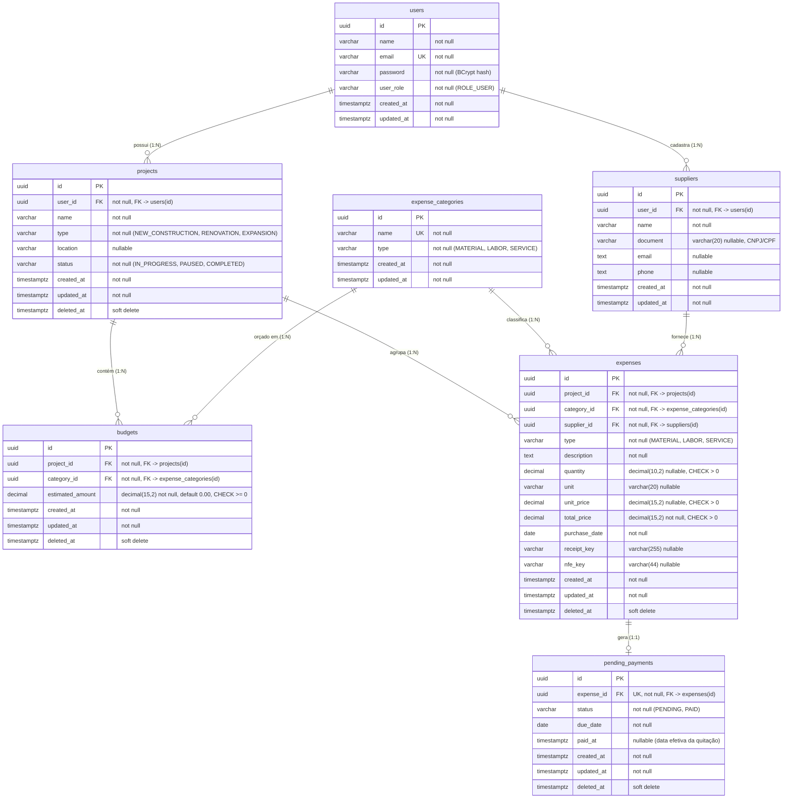
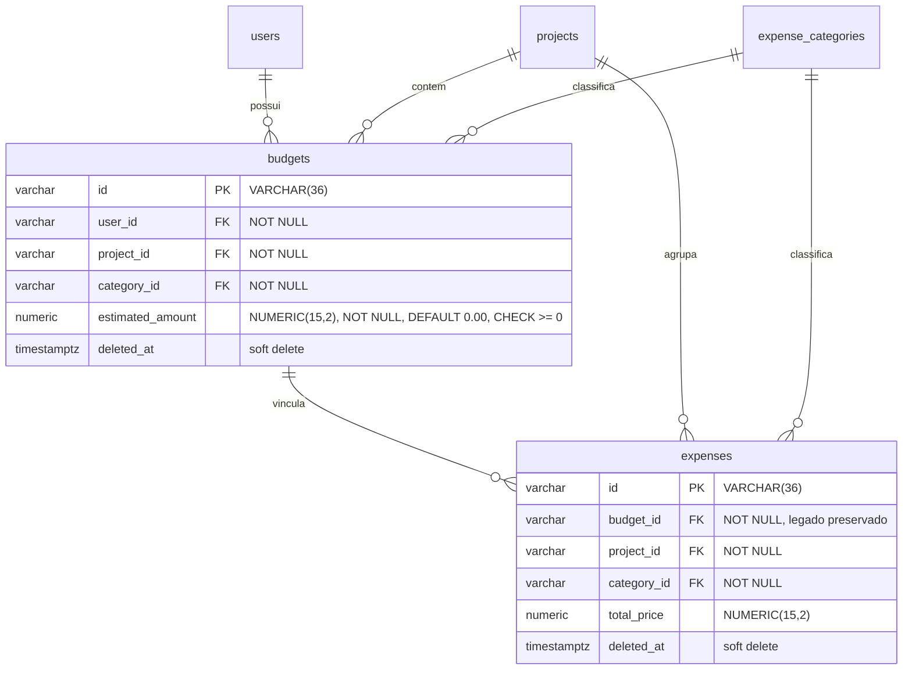
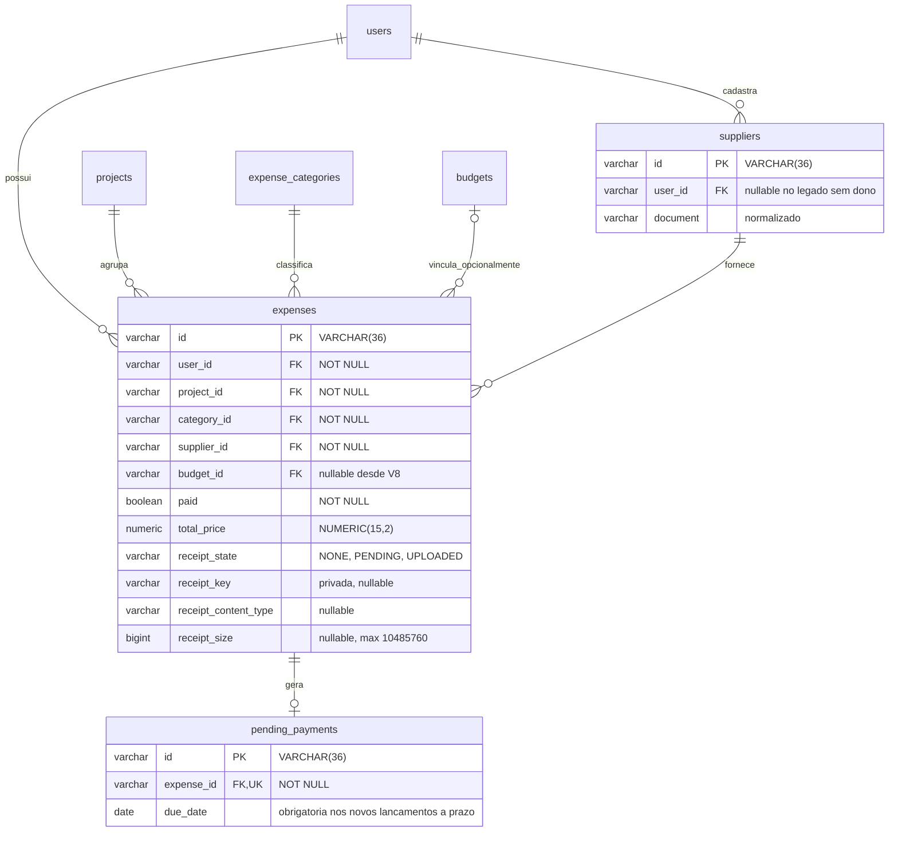

# 📐 Arquitetura do Sistema - ObraCerta!

**Projeto:** ObraCerta (Gestão Financeira de Obras Residenciais)  
**Status do Documento:** 🟢 Definido (Fase 0 - SDD)  
**Versão:** 2.0.0 (Normatizada para o Método UTF-SDD)  
**Última Atualização:** 2026-10-26 (fechamento da implementação da US07)

---

## 🏗️ 1. Estrutura do Monorepo

O projeto adota a arquitetura de **Monorepo**, centralizando a aplicação client (SPA), a API de serviços backend, documentações vivas e especificações de engenharia:

```
obra-certa/
├── .github/
│   └── workflows/
│       └── ci.yml                         # CI atual: testes backend com PostgreSQL de serviço, testes e build frontend
│
├── apps/
│   ├── web/                               # Frontend em Angular 21.2.x
│   │   ├── src/
│   │   │   ├── app/
│   │   │   │   ├── core/                  # Serviços singleton, infraestrutura e segurança
│   │   │   │   │   ├── guards/            # authGuard (proteção de rotas privadas)
│   │   │   │   │   ├── interceptors/      # authInterceptor (JWT; logout e redirecionamento em 401)
│   │   │   │   │   ├── models/            # Interfaces e types TypeScript (espelho dos DTOs)
│   │   │   │   │   └── services/          # Camada única de comunicação HTTP com a API
│   │   │   │   │       ├── auth.ts
│   │   │   │   │       ├── active-project.service.ts  # Signal reativo com persistência em localStorage
│   │   │   │   │       ├── project.service.ts
│   │   │   │   │       ├── expense.service.ts
│   │   │   │   │       ├── budget.service.ts
│   │   │   │   │       ├── category.service.ts
│   │   │   │   │       └── supplier.service.ts
│   │   │   │   ├── shared/                # Componentes puros, pipes e utilitários globais
│   │   │   │   │   ├── components/        # Navbar, Sidebar, KpiCard, RadialGauge, CategoryProgressCard,
│   │   │   │   │   │                      # AlertBanner, StatusBadge, ConfirmModal, EmptyState, ProjectModal
│   │   │   │   │   └── pipes/             # CurrencyBrlPipe, DateBrlPipe
│   │   │   │   └── features/              # Módulos de telas organizados por domínio de negócio
│   │   │   │       ├── auth/              # Login e Cadastro (Register)
│   │   │   │       ├── projects/          # Criação, Edição e Gestão de Obras (US14)
│   │   │   │       ├── dashboard/         # Home com KPIs, gráficos e painel de alertas
│   │   │   │       ├── expenses/          # Listagem paginada, filtros, formulário e modal de NF-e
│   │   │   │       ├── budgets-page/      # Painel de orçamentos e modal de criação/edição (US07)
│   │   │   │       └── reports/           # Relatórios comparativos e exportação de PDF
│   │   │   ├── assets/                    # Ícones SVG, manifest.webmanifest e imagens
│   │   │   └── styles.css                 # Importação do Tailwind v4, DaisyUI v5 e tokens
│   │   ├── Dockerfile                     # Build multi-stage gerando imagem estática Nginx
│   │   ├── nginx.conf                     # Configuração do Nginx com fallback SPA e proxy /api
│   │   ├── package.json                   # Dependências e scripts de teste (Jasmine/Karma)
│   │   └── tsconfig.json                  # strict: true, strictTemplates: true
│   │
│   └── api/                               # Backend RESTful em Java 21 LTS / Spring Boot 3.5.4
│       ├── src/
│       │   ├── main/
│       │   │   ├── java/com/obracerta/
│       │   │   │   ├── configuration/     # SecurityConfig, CorsConfig, OpenApiConfig, ClockConfig
│       │   │   │   ├── controller/        # Controladores REST magros com Bean Validation (@Valid)
│       │   │   │   ├── service/           # Regras de negócio, cálculos, travas orçamentárias e Anti-IDOR
│       │   │   │   ├── repository/        # Spring Data JPA com queries de posse por usuário
│       │   │   │   ├── mapper/            # Conversão Entity ↔ DTO e envelopamento PageResponse<T>
│       │   │   │   ├── model/
│       │   │   │   │   ├── dto/           # Java Records imutáveis para entrada e saída de dados
│       │   │   │   │   └── entity/        # Entidades JPA; tipos físicos definidos pelas migrations
│       │   │   │   ├── security/          # TokenService (JWT), SecurityFilter e UserContextHelper
│       │   │   │   ├── integration/       # Cliente de integração e parser de NF-e (XML / API)
│       │   │   │   ├── exception/         # RestControllerAdvice e hierarquia de exceções de negócio
│       │   │   │   └── enums/             # ProjectType, ProjectStatus, BudgetState e enums de despesas
│       │   │   └── resources/
│       │   │       ├── db/migration/      # Migrations versionadas e imutáveis do Flyway (V1, V2...)
│       │   │       ├── application.properties       # Propriedades gerais
│       │   │       ├── application-dev.properties   # Perfil de desenvolvimento (Postgres Docker)
│       │   │       ├── application-test.properties  # PostgreSQL fornecido por ambiente/serviço de CI
│       │   │       └── application-prod.properties  # Perfil de produção (Neon Serverless)
│       │   └── test/                      # JUnit 5, Mockito e integração com PostgreSQL
│       ├── Dockerfile                     # Empacotamento em container OCI da aplicação Spring Boot
│       └── pom.xml                        # Maven, Spring Boot, Flyway e dependências de teste
│
├── docs/                                  # Documentação Viva (Fase 0 - SDD)
│   ├── prd.md                             # Requisitos, Histórias e Regras de Negócio
│   ├── design-tokens.md                   # Tokens visuais, Breakpoints, PWA e Desistência
│   ├── architecture.md                    # Arquitetura Técnica do Sistema (este documento)
│   └── user-flows.md                      # Diagramas de Jornadas e Mitigações
│
├── specs/                                 # Especificações por Issue (Ordem de Serviço do SDD)
├── docker-compose.yml                     # PostgreSQL, backend e frontend; storage externo no Supabase
├── .env.example                           # Template de variáveis de ambiente sem segredos
└── README.md                              # Guia de início rápido e visão geral do projeto
```

---

## 🌐 2. Diagrama de Contexto do Sistema



---

## 🗄️ 3. Modelo de Dados (MER Consolidado)

O schema físico do PostgreSQL é versionado pelo **Flyway**. O MER consolidado abaixo é o modelo lógico alvo, incluindo atributos de histórias ainda não implementadas; não substitui as migrations. No schema versionado desta entrega (V1–V9), os identificadores UUID são armazenados em `VARCHAR(36)`, valores monetários usam `NUMERIC(15,2)` e os tipos temporais seguem cada migration. A notação `uuid` do modelo lógico não implica uma conversão física já aplicada. Os recortes por história abaixo documentam a evolução implementada.



### Persistência implementada na US07 (V6–V7, antes da US03)

- A V6 normaliza valores nulos para `0.00`, define `NOT NULL`, `DEFAULT 0.00` e `CHECK (estimated_amount >= 0)`. Antes de criar o índice único ativo por obra/categoria, exclui logicamente duplicatas, preservando a mais recente e os vínculos das despesas.
- A V7 insere as nove categorias pré-definidas somente quando seus nomes ainda não existem. A aplicação consulta essas categorias no banco.
- Na entrega da US07, `expenses.budget_id` permanecia obrigatório no schema legado. Despesas sem teto eram representadas por orçamento zerado; a leitura também suporta despesa sem orçamento ativo, como quando o registro vinculado está excluído logicamente. A US03 flexibiliza esse vínculo na V8.
- Neste recorte do MER, as colunas mostram os vínculos e valores usados pelo orçamento; os demais atributos permanecem definidos nas migrations.



### Persistência implementada na US03 (V8–V9)

- **V8:** torna `expenses.budget_id` opcional e acrescenta `paid`. Despesa sem teto não exige orçamento artificial; despesa a prazo gera pagamento pendente na mesma transação. Fornecedores recebem `user_id`; o backfill clona fornecedores compartilhados por contas e religa as despesas. Fornecedores legados sem referência permanecem sem proprietário e não são expostos na seleção.
- **V9:** persiste `receipt_state` (`NONE`, `PENDING`, `UPLOADED`), chave privada, tipo e tamanho. A constraint exige ausência de metadados em `NONE/PENDING` e metadados completos em `UPLOADED`. `receipt_url` legado é mantido para auditoria, sem presumir que exista arquivo confirmado.
- A entrega termina na tarefa 8. Não inclui tabela de idempotência nem recuperação de rascunho após sessão expirada. O recorte abaixo destaca as relações e colunas afetadas; o restante do schema continua nas migrations.



### Constraints e Índices Especiais no PostgreSQL:
O índice de orçamento do item 1 está implementado pela V6. Os demais itens descrevem a evolução do modelo; sua aplicação física deve ser conferida nas migrations da respectiva história.
1. **Índice Único Parcial para Orçamento Único por Categoria:**
   `CREATE UNIQUE INDEX idx_budgets_project_category_active ON budgets (project_id, category_id) WHERE deleted_at IS NULL;`
2. **Índice Único Parcial para Chave de NF-e na Obra:**
   `CREATE UNIQUE INDEX idx_expenses_project_nfe_active ON expenses (project_id, nfe_key) WHERE deleted_at IS NULL AND nfe_key IS NOT NULL;`
3. **Índice Único Parcial para Fornecedor por Usuário:**
   `CREATE UNIQUE INDEX idx_suppliers_user_document_active ON suppliers (user_id, document) WHERE document IS NOT NULL;`
4. **Índices de Performance para Filtros e Painéis:**
   - `CREATE INDEX idx_expenses_project_date ON expenses (project_id, purchase_date) WHERE deleted_at IS NULL;`
   - `CREATE INDEX idx_expenses_project_category ON expenses (project_id, category_id) WHERE deleted_at IS NULL;`
   - `CREATE INDEX idx_payments_status_due ON pending_payments (status, due_date) WHERE deleted_at IS NULL;`

---

## 📖 4. Glossário Técnico (Mapeamento PT-BR ➔ EN)

| Conceito de Negócio (PT-BR) | Entidade JPA / DTO (EN) | Tabela PostgreSQL | Coleção / Rota API |
| :--- | :--- | :--- | :--- |
| **Usuário** | `User` / `RegisterUserDTO`, `AuthDTO` | `users` | `/api/auth` |
| **Obra (Projeto)** | `Project` / `ProjectDTO` | `projects` | `/api/projects` |
| **Categoria de Despesa** | `ExpenseCategory` / `CategoryResponseDTO` | `expense_categories` | `/api/expense-categories` |
| **Fornecedor** | `Supplier` / `SupplierDTO` | `suppliers` | `/api/suppliers` |
| **Orçamento Previsto** | `Budget` / `BudgetSetDTO`, `BudgetCategoryDTO`, `BudgetOverviewDTO` | `budgets` | `/api/budgets` |
| **Despesa (Gasto Real)** | `Expense` / `ExpenseCreateDTO`, `ExpenseResponseDTO` | `expenses` | `/api/expenses` |
| **Pagamento Pendente** | `PendingPayment` / `PaymentDTO` | `pending_payments` | `/api/pending-payments` |

---

## 🏛️ 5. Padrões Arquiteturais

### 5.1 Frontend (Angular 21.2.x)

1. **Componentes Standalone:** Padrão moderno desprovido de `NgModule`.
2. **Gerenciamento de Estado Reativo com Signals:** Utilização de `signal()`, `computed()` e `effect()` para gerenciar o estado reativo das telas e componentes.
3. **Controle de Fluxo Moderno:** Adoção estrita de `@if`, `@for`, `@switch` no lugar de diretivas legadas (`*ngIf`, `*ngFor`).
4. **Formulários:** Uso de `ReactiveFormsModule` com validação de consistência temporal e tipagem forte.
5. **Injeção de Dependências:** Uso exclusivo da função `inject()`.
6. **Estado da Obra Ativa (`ActiveProjectService`):** O projeto ativo selecionado reside em um Signal global no `ActiveProjectService`, com persistência automática no `localStorage`. Todas as telas e componentes consomem esse estado reativo, eliminando seletores locais redundantes.
7. **Regra de Ouro da Camada de Dados:**
   - Nenhum componente acessa o `HttpClient` diretamente;
   - Todas as requisições passam obrigatoriamente por serviços em `core/services/`;
   - Retornos fortemente tipados via `Observable<T>` (proibido uso de `any`);
   - `authInterceptor` anexa o JWT, encerra a sessão no `401` e propaga o erro. Falhas de rede/5xx e erros de domínio chegam aos componentes para feedback e nova tentativa, sem transformar falha em sucesso.

8. **Painel de orçamento (US07):** a recarga automática observa o identificador da obra, não a referência do objeto. Atualizar a lista da navbar ou os metadados da mesma obra não recarrega orçamento/categorias nem descarta diálogos. Troca real de obra fecha os diálogos, limpa o contexto e ignora respostas antigas, inclusive no ciclo A → B → A.
9. **Valor monetário no formulário:** máscara local BRL interpreta os dígitos como centavos (`123456` → `R$ 1.234,56`), mantendo o controle e o DTO numéricos em reais (`1234.56`). Valores existentes são formatados sem nova divisão por cem. Vazio e zero continuam inválidos no formulário; zerar exige a confirmação explícita.
10. **Sessão e recuperação:** `/` e `/login` abrem o mesmo Login; `Auth.logout()` remove token e obra ativa antes de navegar para `/login`. Erros preservam formulário ou confirmação e reabilitam nova tentativa. Uma resposta perdida não prova que o servidor deixou de gravar.
11. **Contexto das despesas (US03):** `ActiveProjectService` expõe signals somente para leitura e uma versão de contexto que muda sincronamente ao trocar o identificador da obra. Formulário e consulta limpam o contexto anterior e ignoram respostas antigas, inclusive A → B → A. Atualizar metadados da mesma obra não descarta os campos. O cadastro não restaura rascunho após novo login; `401` mantém o encerramento da sessão existente.

### 5.2 Backend (Java 21 LTS / Spring Boot 3.5.4)

1. **Arquitetura em Camadas com Sentido Único:**
   - `Controller` ➔ `Service` ➔ `Repository` ➔ `Entity`.
   - **Controllers são magros:** apenas recebem, validam via `@Valid`, delegam ao service e retornam DTOs com o status HTTP correspondente. **É proibido injetar Repositories em Controllers**.
   - **Services concentram 100% da lógica:** cálculos, validações de teto orçamentário, checagens de datas e validações de Anti-IDOR.
2. **Fronteira com DTOs em Java Records:**
   - Entidades JPA nunca atravessam a camada de Controller. A conversão é feita na camada `mapper/` de forma explícita e tipada.
   - No agregado financeiro da US07, o `BudgetService` compõe `BudgetCategoryDTO` e `BudgetOverviewDTO` a partir dos orçamentos e das projeções de despesas, junto aos cálculos. A API continua expondo somente records, nunca entidades JPA.
3. **Formato Único de Erro (`@RestControllerAdvice`):**
   - Todas as falhas devolvem um payload estruturado e padronizado:
   ```json
   {
     "timestamp": "2026-10-15T20:00:00Z",
     "status": 409,
     "error": "Conflict",
     "message": "O orçamento não pode ser menor do que o total de despesas já realizadas nesta categoria: R$ 5.000,00",
     "path": "/api/budgets/3fa85f64-5717-4562-b3fc-2c963f66afa6/categories/categoria-id",
     "fieldErrors": []
   }
   ```
   - **Semântica de Códigos HTTP:**
     - `400 Bad Request`: falhas de validação de payload (`@Valid`), campos faltantes ou inválidos;
     - `401 Unauthorized`: ausência de autenticação válida, incluindo JWT ausente, inválido ou expirado. A cadeia do Spring Security deve devolver 401 para acionar o encerramento de sessão no frontend;
     - `403 Forbidden`: usuário autenticado sem a permissão exigida pela rota;
     - `404 Not Found`: recurso não localizado ou tentativa de acesso a dados de terceiros (Anti-IDOR);
     - `409 Conflict`: violação de regra de negócio de estado existente (RN02 de orçamento ou violações de unicidade de banco);
     - `500 Internal Server Error`: erro interno genérico não mapeado, omitindo stack traces do cliente.
4. **Relógio Injetável (`java.time.Clock`):**
   - Classes de serviço que operam sobre datas (validação de vencimento e horizonte de 7 dias) injetam `Clock`, permitindo fixar instantes temporais em testes com `Clock.fixed()`.

---

## 📡 6. Contrato e Convenções de API

1. **Prefixos e Verbos:**
   - Prefixo obrigatório: `/api/`;
   - Recursos no plural, em inglês e kebab-case (`/api/projects`, `/api/expenses`, `/api/expense-categories`, `/api/budgets`);
   - Métodos semânticos: `POST` de criação retorna `201 Created` com header `Location`; `GET` retorna `200 OK`; `PUT`/`PATCH` retorna `200 OK`; `DELETE` retorna `204 No Content` no primeiro e `404 Not Found` em repetições. A ação `POST .../zero` da US07 retorna `200 OK` com o orçamento recalculado, pois atualiza um registro existente.
2. **Padrão de Paginação com Summary Agregado (`PageResponse<T>`):**
   - Para consultas volumosas (despesas), utiliza-se o padrão com summary financeiro agregado:
   ```json
   {
     "content": [ /* lista de DTOs da página */ ],
     "page": 0,
     "size": 15,
     "totalElements": 45,
     "totalPages": 3,
     "last": false,
     "summary": {
       "totalPaid": 12500.00,
       "totalPending": 3400.00,
       "totalGeneral": 15900.00
     }
   }
   ```
   - Limite padrão configurado: `spring.data.web.pageable.max-page-size=100`.
   - Listas pequenas, como categorias, retornam `List<T>` com `200 OK`. O painel de orçamento retorna um objeto `BudgetOverviewDTO`, contendo totais e a lista `categories`.
3. **Escopo por Obra:**
   - Consultas de coleções filtram via query parameter obrigatório: `?projectId=<uuid>`.
   - Leituras agregadas da obra residem sob: `GET /api/projects/{id}/reports/pdf`.
4. **Documentação OpenAPI / Swagger:**
   - Habilitado em desenvolvimento sob `/swagger-ui.html` e `/v3/api-docs` com esquema de segurança `bearerAuth` configurado para permitir testes diretos no navegador;
   - Desabilitado no perfil de produção (`springdoc.swagger-ui.enabled=false`).

### Contrato implementado da US07

| Método e caminho | Retorno | Comportamento |
| --- | --- | --- |
| `GET /api/expense-categories` | `200`, `List<CategoryResponseDTO>` | Categorias do banco, ordenadas por nome em pt-BR. |
| `GET /api/budgets?projectId={id}` | `200`, `BudgetOverviewDTO` | Totais da obra e categorias com orçamento ativo ou despesas ativas. |
| `PUT /api/budgets/{projectId}/categories/{categoryId}` | `200`, `BudgetCategoryDTO` | Cria ou atualiza um único orçamento ativo; corpo `BudgetSetDTO` com `estimatedAmount`. |
| `POST /api/budgets/{projectId}/categories/{categoryId}/zero` | `200`, `BudgetCategoryDTO` | Grava `0.00` no registro ativo existente, sem apagá-lo; chamadas repetidas preservam o resultado. |

- Todas as operações de orçamento validam primeiro a obra do usuário autenticado. Obra inexistente ou alheia retorna `404 Projeto não encontrado`; nas escritas, categoria inexistente retorna `404 Categoria não encontrada`. Zeramento sem orçamento ativo retorna `404 Orçamento não encontrado`.
- O PUT exige valor positivo com até duas casas decimais (`400` se inválido); valor positivo inferior ao gasto ativo da categoria gera `409` sem alterar o registro. Igualdade com o gasto é aceita.
- Os cálculos somam apenas despesas com `deleted_at IS NULL`, incluindo pagas e pendentes. Saldo pode ser negativo; percentual é nulo quando o teto é zero, evitando divisão por zero.
- `BudgetState`: `ON_TRACK` abaixo de 90%, `WARNING` de 90% até abaixo de 100%, `EXCEEDED` a partir de 100% e `NO_BUDGET` quando o teto é zero. O estado usa a razão exata; o percentual exibido é arredondado para uma casa decimal. `hasBudget` informa a existência do registro ativo, mesmo zerado.
- `BudgetOverviewDTO` reúne `projectId`, `totalPlanned`, `totalSpent`, `available`, `globalPercentage`, `exceededCategories`, `budgetedCategories` e `categories`. Cada `BudgetCategoryDTO` informa categoria, planejado, gasto, saldo, percentual, estado e `hasBudget`.
- O alerta de despesas sem teto oferece “Definir teto”. Os atalhos de despesas permanecem visíveis e desabilitados até US04/US05, com a dependência informada no tooltip.

---

### Contrato implementado da US03

| Método e caminho | Retorno | Comportamento |
| --- | --- | --- |
| `GET /api/suppliers` | `200`, lista de fornecedores | Somente fornecedores do usuário autenticado. |
| `POST /api/expenses` | `201`, `ExpenseResponseDTO` e `Location` | Recebe `ExpenseCreateDTO`; seleciona fornecedor existente ou cria inline. Grava despesa e eventual pagamento atomicamente. Sem contrato de idempotência neste recorte. |
| `GET /api/expenses/{id}` | `200`, `ExpenseResponseDTO` | Consulta individual com quitação, vencimento e estado de comprovante; não expõe URL pública do storage. |
| `PUT /api/expenses/{id}/receipt` | `200`, `ExpenseResponseDTO` | Multipart `file`, após despesa salva; falha não desfaz os registros financeiros. Reenvio atua sobre a mesma despesa. |
| `GET /api/expenses/{id}/receipt` | `200`, arquivo | Leitura autenticada, com nome seguro, `no-store` e `nosniff`. |

- Serviço valida obra ativa do proprietário, categoria e fornecedor. Leituras e upload recusam obra/despesa excluída; recurso alheio ou inexistente retorna `404`, antes de acessar storage.
- No cadastro inline, nome do fornecedor é obrigatório e CNPJ é opcional. A tela aplica máscara `00.000.000/0000-00`; a API valida 14 dígitos quando preenchido e normaliza a pontuação. Ausência de documento é persistida como `NULL` e não é usada para reutilizar fornecedores. A coluna já aceita nulo; nenhuma migration adicional é necessária.
- Modo direto exige total; modo calculado exige quantidade e valor unitário, calcula com `BigDecimal` e arredonda o total com `HALF_UP`. Pagamento a prazo exige vencimento igual ou posterior à compra. Gastos continuam no agregado da US07; alertas de teto ausente ou consumo de pelo menos 100% não bloqueiam a gravação.
- Comprovantes: MIME declarado e extensão correspondente JPEG/PNG/PDF; arquivo não vazio e até 10 MiB (10 × 1024 × 1024 bytes). Sem inspeção de bytes, decodificação de imagens ou biblioteca de PDF. Tipo inválido retorna `400`; tamanho excedido, `413`.
- Apenas sucesso do Supabase confirma `UPLOADED`. A consulta exibe “Sem comprovante” sem arquivo confirmado; falha de envio preserva despesa e pagamento e oferece reenvio posterior. Substituição/remoção de arquivo confirmado e listagem completa ficam para histórias posteriores.
- Entrada: `/contas` → “Cadastrar conta” → `/contas/nova`; consulta individual em `/despesas/:id`.

---

## 🛡️ 7. Segurança, Isolamento e Soft Delete

1. **Autenticação Stateless (JWT):**
   - Emissão de token assinado via HMAC256 com validade configurada (7 dias);
   - Transmissão no cabeçalho `Authorization: Bearer <token>`.
2. **Anti-IDOR Centralizado no Servidor:**
   - Em todas as operações de leitura, edição ou exclusão, os repositórios filtram por `project.user.id = :authUserId`;
   - Se o identificador referenciar recurso de outro usuário, o sistema responde com `404 Not Found` (não revelando a existência do dado).
3. **Anti-IDOR Cruzado de Referências:**
   - Ao vincular um `supplier_id` em uma despesa, o serviço valida que o fornecedor pertence ao mesmo usuário dono da obra.
4. **Política de Soft Delete e Integridade:**
   - Exclusão de obra marca `deleted_at = now()` em `projects` e propaga o carimbo para `budgets`, `expenses` e `pending_payments` filhos;
   - Exclusão de despesa marca `deleted_at` na despesa e no pagamento pendente, e remove fisicamente o arquivo do comprovante do storage.

---

## ⚙️ 8. Ambientes e Persistência

| Configuração | Desenvolvimento (`dev`) | Testes e CI (`test`) | Produção (`prod`) |
| :--- | :--- | :--- | :--- |
| **Banco de Dados** | PostgreSQL 16+ via Docker Compose | PostgreSQL 16 fornecido pelo ambiente ou serviço da CI | Neon Serverless PostgreSQL |
| **Conexão** | `localhost:5432` | `SPRING_DATASOURCE_URL`, usuário e senha por ambiente | Pooling (`-pooler`) com `prepareThreshold=0` |
| **Flyway** | Executado na subida (`validate`) | Executado na subida (`validate`) | String direta (sem pooler) para advisory locks |
| **Comprovantes** | Supabase Storage S3; bucket privado de desenvolvimento, requer internet | Substituto controlado e HTTP local, sem conta real | Supabase Storage S3; bucket privado e credenciais exclusivos de produção |
| **Frontend** | Angular CLI (`localhost:4200`) | Jasmine/Karma com ChromeHeadless | Build estático; hospedagem conforme configuração de implantação |
| **Backend** | Spring Boot CLI (`localhost:8080`) | JUnit 5 + SpringBootTest | Container Docker gerenciado sob HTTPS |

- **Configuração de comprovantes:** `RECEIPT_STORAGE_*` no `.env` da raiz, preenchido manualmente. O Compose usa `env_file`; o Spring importa opcionalmente esse arquivo ao executar da raiz ou de `apps/api`. As chaves S3 ficam apenas no backend; como elas ignoram RLS, a API valida a posse antes de acessar objetos. PostgreSQL e autenticação JWT existentes são preservados. O roteiro de configuração e validação está em [supabase-storage.md](./supabase-storage.md). A inicialização financeira não depende de credenciais ou conexão com o storage.

- **Regra de Ouro das Migrações:**
  - `spring.jpa.hibernate.ddl-auto=validate` em todos os perfis;
  - Toda alteração de schema gera arquivo versionado `apps/api/src/main/resources/db/migration/V<N>__<descricao>.sql`;
  - Migrações commitadas são imutáveis; correções são feitas sempre para frente (`V<N+1>`);
  - As categorias de despesas pré-definidas são inseridas como dados mestres via migration do Flyway.

- **Demonstração da US07:** `DemoDataSeederRunner` existe somente no perfil `dev` e com `SEED_ENABLED=true`; fica desligado por padrão. Ele delega ao seeder idempotente de usuário/obra/orçamentos/despesas, permitindo demonstrar o painel antes da entrega do cadastro de despesas. Dados e credenciais de demonstração não são configuração de produção.

---

## 🧪 9. Estratégia de Testes e Qualidade

1. **Frontend (`apps/web`):**
   - **Framework atual:** Jasmine/Karma, configurado em `apps/web/angular.json`;
   - **Comando de Testes:** `npx ng test --watch=false --browsers=ChromeHeadless` (`npx.cmd` no Windows);
   - **Comando de Verificação de Tipos e Build:** `npm run build` (com `strictTemplates: true`);
   - **Seletores:** Uso de atributos `data-testid` para testes resilientes a mudanças visuais de CSS.
2. **Backend (`apps/api`):**
   - **Pirâmide de Testes:**
     - Testes unitários puros com Mockito em `service/`;
     - Testes de repositório e constraints com `@DataJpaTest` e PostgreSQL real fornecido pelo ambiente, com Flyway e `ddl-auto=validate`;
     - Testes de controlador com `@WebMvcTest` validando `@Valid`, status HTTP e payload de erro;
     - Testes ponta a ponta com `@SpringBootTest` cobrindo o fluxo de login JWT e testes de Anti-IDOR (usuário B recebendo 404 em recurso do usuário A).
   - **Execução atual:** `./mvnw test` (Linux/Mac) ou `.\mvnw.cmd test` (Windows), com `SPRING_PROFILES_ACTIVE=test` e as variáveis de conexão do PostgreSQL configuradas. O ciclo Maven `verify` pode ser usado para validação completa;
   - **Cobertura:** o `pom.xml` atual não configura JaCoCo; não há relatório ou limite automático de cobertura declarado como entregue nesta história.
3. **CI (GitHub Actions):**
   - O workflow atual executa, nos PRs para `develop`/`main`, os testes backend com PostgreSQL de serviço e, no frontend, `ng test` em ChromeHeadless seguido do build.
