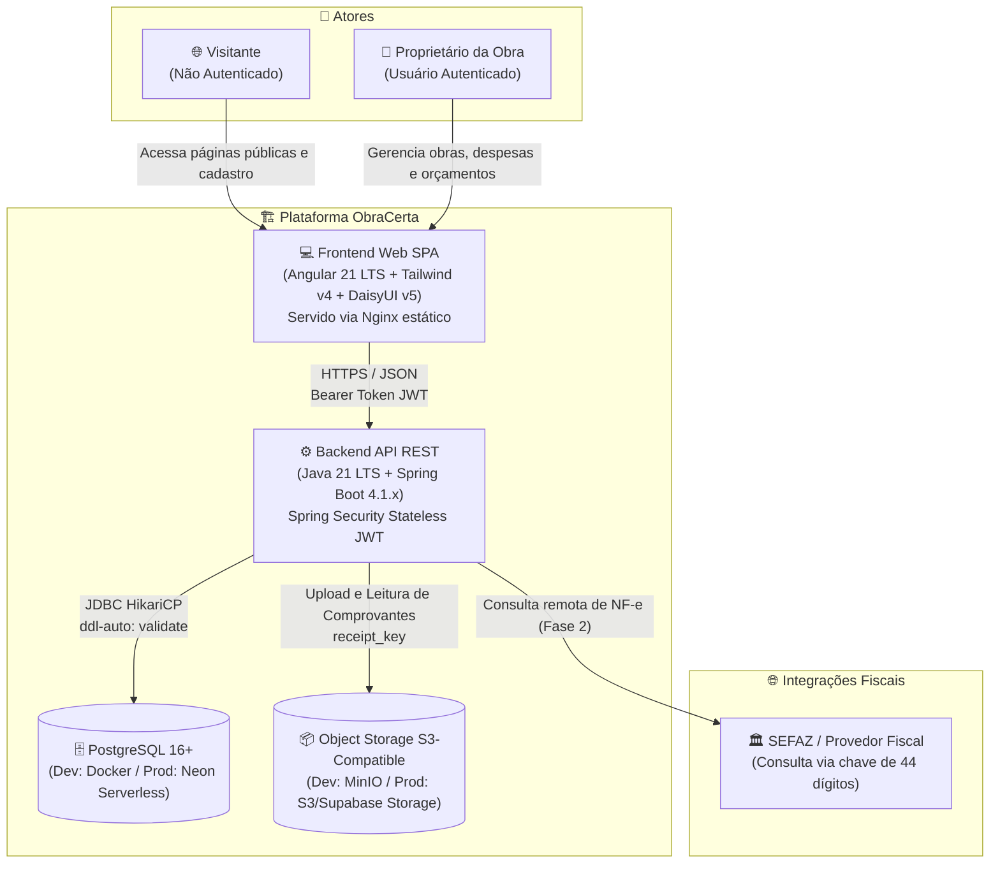

# 📐 Arquitetura do Sistema - ObraCerta!

**Projeto:** ObraCerta (Gestão Financeira de Obras Residenciais)  
**Status do Documento:** 🟢 Definido (Fase 0 - SDD)  
**Versão:** 2.0.0 (Normatizada para o Método UTF-SDD)  
**Última Atualização:** 2026-10-15

---

## 🏗️ 1. Estrutura do Monorepo

O projeto adota a arquitetura de **Monorepo**, centralizando a aplicação client (SPA), a API de serviços backend, documentações vivas e especificações de engenharia:

```
obra-certa/
├── .github/
│   └── workflows/
│       └── ci.yml                         # Pipeline de CI (build, linters, testes com Testcontainers)
│
├── apps/
│   ├── web/                               # Frontend SPA em Angular 21 LTS (CSR estático)
│   │   ├── src/
│   │   │   ├── app/
│   │   │   │   ├── core/                  # Serviços singleton, infraestrutura e segurança
│   │   │   │   │   ├── guards/            # authGuard (proteção de rotas privadas)
│   │   │   │   │   ├── interceptors/      # authInterceptor (anexação de JWT e reautenticação inline)
│   │   │   │   │   ├── models/            # Interfaces e types TypeScript (espelho dos DTOs)
│   │   │   │   │   └── services/          # Camada única de comunicação HTTP com a API
│   │   │   │   │       ├── auth.service.ts
│   │   │   │   │       ├── active-project.service.ts  # Signal reativo com persistência em localStorage
│   │   │   │   │       ├── project.service.ts
│   │   │   │   │       ├── expense.service.ts
│   │   │   │   │       ├── budget.service.ts
│   │   │   │   │       ├── category.service.ts
│   │   │   │   │       └── supplier.service.ts
│   │   │   │   ├── shared/                # Componentes puros, pipes e utilitários globais
│   │   │   │   │   ├── components/        # Navbar, Sidebar, KpiCard, RadialGauge, CategoryProgressCard,
│   │   │   │   │   │                      # AlertBanner, StatusBadge, ConfirmModal, EmptyState, ProjectModal
│   │   │   │   │   └── pipes/             # CurrencyBrlPipe, DateBrlPipe
│   │   │   │   └── features/              # Módulos de telas organizados por domínio de negócio
│   │   │   │       ├── auth/              # Login e Cadastro (Register)
│   │   │   │       ├── projects/          # Criação, Edição e Gestão de Obras (US14)
│   │   │   │       ├── dashboard/         # Home com KPIs, gráficos e painel de alertas
│   │   │   │       ├── expenses/          # Listagem paginada, filtros, formulário e modal de NF-e
│   │   │   │       ├── budgets/           # Gestão de orçamentos e acompanhamento de tetos
│   │   │   │       └── reports/           # Relatórios comparativos e exportação de PDF
│   │   │   ├── assets/                    # Ícones SVG, manifest.webmanifest e imagens
│   │   │   └── styles.css                 # Importação do Tailwind v4, DaisyUI v5 e tokens
│   │   ├── Dockerfile                     # Build multi-stage gerando imagem estática Nginx
│   │   ├── nginx.conf                     # Configuração do Nginx com fallback SPA e proxy /api
│   │   ├── package.json                   # Dependências e scripts de teste (Vitest)
│   │   └── tsconfig.json                  # strict: true, strictTemplates: true
│   │
│   └── api/                               # Backend RESTful em Java 21 LTS / Spring Boot 4.1.x
│       ├── src/
│       │   ├── main/
│       │   │   ├── java/com/obracerta/
│       │   │   │   ├── configuration/     # SecurityConfig, CorsConfig, OpenApiConfig, ClockConfig
│       │   │   │   ├── controller/        # Controladores REST magros com Bean Validation (@Valid)
│       │   │   │   ├── service/           # Regras de negócio, cálculos, travas orçamentárias e Anti-IDOR
│       │   │   │   ├── repository/        # Spring Data JPA com queries de posse por usuário
│       │   │   │   ├── mapper/            # Conversão Entity ↔ DTO e envelopamento PageResponse<T>
│       │   │   │   ├── model/
│       │   │   │   │   ├── dto/           # Java Records imutáveis para entrada e saída de dados
│       │   │   │   │   └── entity/        # Entidades JPA mapeadas com UUID e timestamptz nativos
│       │   │   │   ├── security/          # TokenService (JWT), SecurityFilter e UserContextHelper
│       │   │   │   ├── integration/       # Cliente de integração e parser de NF-e (XML / API)
│       │   │   │   ├── exception/         # RestControllerAdvice e hierarquia de exceções de negócio
│       │   │   │   └── enums/             # ProjectType, ProjectStatus, ExpenseType, PaymentStatus
│       │   │   └── resources/
│       │   │       ├── db/migration/      # Migrations versionadas e imutáveis do Flyway (V1, V2...)
│       │   │       ├── application.properties       # Propriedades gerais
│       │   │       ├── application-dev.properties   # Perfil de desenvolvimento (Postgres Docker)
│       │   │       ├── application-test.properties  # Perfil de testes (Testcontainers)
│       │   │       └── application-prod.properties  # Perfil de produção (Neon Serverless)
│       │   └── test/                      # Testes com JUnit 5, Mockito e Testcontainers Singleton
│       ├── Dockerfile                     # Empacotamento em container OCI da aplicação Spring Boot
│       └── pom.xml                        # Gerenciador Maven, Flyway, Testcontainers e JaCoCo
│
├── docs/                                  # Documentação Viva (Fase 0 - SDD)
│   ├── prd.md                             # Requisitos, Histórias e Regras de Negócio
│   ├── design-tokens.md                   # Tokens visuais, Breakpoints, PWA e Desistência
│   ├── architecture.md                    # Arquitetura Técnica do Sistema (este documento)
│   └── user-flows.md                      # Diagramas de Jornadas e Mitigações
│
├── specs/                                 # Especificações por Issue (Ordem de Serviço do SDD)
├── docker-compose.yml                     # Orquestração de serviços locais (PostgreSQL, MinIO/Storage)
├── .env.example                           # Template de variáveis de ambiente sem segredos
└── README.md                              # Guia de início rápido e visão geral do projeto
```

---

## 🌐 2. Diagrama de Contexto do Sistema



---

## 🗄️ 3. Modelo de Dados (MER Consolidado)

O schema do banco de dados PostgreSQL é estritamente versionado pelo **Flyway**. Todas as chaves primárias são do tipo nativo `uuid`, valores monetários utilizam `decimal(15,2)` e carimbos de tempo utilizam `timestamptz` (Instant UTC).

```mermaid
erDiagram
    users ||--o{ projects : "possui (1:N)"
    users ||--o{ suppliers : "cadastra (1:N)"
    
    projects ||--o{ budgets : "contém (1:N)"
    projects ||--o{ expenses : "agrupa (1:N)"
    
    expense_categories ||--o{ budgets : "orçado em (1:N)"
    expense_categories ||--o{ expenses : "classifica (1:N)"
    
    suppliers ||--o{ expenses : "fornece (1:N)"
    expenses ||--o| pending_payments : "gera (1:1)"

    users {
        uuid id PK
        varchar name "not null"
        varchar email UK "not null"
        varchar password "not null (BCrypt hash)"
        varchar user_role "not null (ROLE_USER)"
        timestamptz created_at "not null"
        timestamptz updated_at "not null"
    }

    projects {
        uuid id PK
        uuid user_id FK "not null, FK -> users(id)"
        varchar name "not null"
        varchar type "not null (NEW_CONSTRUCTION, RENOVATION, EXPANSION)"
        varchar location "nullable"
        varchar status "not null (IN_PROGRESS, PAUSED, COMPLETED)"
        timestamptz created_at "not null"
        timestamptz updated_at "not null"
        timestamptz deleted_at "soft delete"
    }

    expense_categories {
        uuid id PK
        varchar name UK "not null"
        varchar type "not null (MATERIAL, LABOR, SERVICE)"
        timestamptz created_at "not null"
        timestamptz updated_at "not null"
    }

    budgets {
        uuid id PK
        uuid project_id FK "not null, FK -> projects(id)"
        uuid category_id FK "not null, FK -> expense_categories(id)"
        decimal estimated_amount "decimal(15,2) not null, CHECK > 0"
        timestamptz created_at "not null"
        timestamptz updated_at "not null"
        timestamptz deleted_at "soft delete"
    }

    suppliers {
        uuid id PK
        uuid user_id FK "not null, FK -> users(id)"
        varchar name "not null"
        varchar document "varchar(20) nullable, CNPJ/CPF"
        text email "nullable"
        text phone "nullable"
        timestamptz created_at "not null"
        timestamptz updated_at "not null"
    }

    expenses {
        uuid id PK
        uuid project_id FK "not null, FK -> projects(id)"
        uuid category_id FK "not null, FK -> expense_categories(id)"
        uuid supplier_id FK "not null, FK -> suppliers(id)"
        varchar type "not null (MATERIAL, LABOR, SERVICE)"
        text description "not null"
        decimal quantity "decimal(10,2) nullable, CHECK > 0"
        varchar unit "varchar(20) nullable"
        decimal unit_price "decimal(15,2) nullable, CHECK > 0"
        decimal total_price "decimal(15,2) not null, CHECK > 0"
        date purchase_date "not null"
        varchar receipt_key "varchar(255) nullable"
        varchar nfe_key "varchar(44) nullable"
        timestamptz created_at "not null"
        timestamptz updated_at "not null"
        timestamptz deleted_at "soft delete"
    }

    pending_payments {
        uuid id PK
        uuid expense_id FK "UK, not null, FK -> expenses(id)"
        varchar status "not null (PENDING, PAID)"
        date due_date "not null"
        timestamptz paid_at "nullable (data efetiva da quitação)"
        timestamptz created_at "not null"
        timestamptz updated_at "not null"
        timestamptz deleted_at "soft delete"
    }
```



### Constraints e Índices Especiais no PostgreSQL:
1. **Índice Único Parcial para Orçamento Único por Categoria:**
   `CREATE UNIQUE INDEX idx_budgets_project_category_active ON budgets (project_id, category_id) WHERE deleted_at IS NULL;`
2. **Índice Único Parcial para Chave de NF-e na Obra:**
   `CREATE UNIQUE INDEX idx_expenses_project_nfe_active ON expenses (project_id, nfe_key) WHERE deleted_at IS NULL AND nfe_key IS NOT NULL;`
3. **Índice Único Parcial para Fornecedor por Usuário:**
   `CREATE UNIQUE INDEX idx_suppliers_user_document_active ON suppliers (user_id, document) WHERE document IS NOT NULL;`
4. **Índices de Performance para Filtros e Painéis:**
   - `CREATE INDEX idx_expenses_project_date ON expenses (project_id, purchase_date) WHERE deleted_at IS NULL;`
   - `CREATE INDEX idx_expenses_project_category ON expenses (project_id, category_id) WHERE deleted_at IS NULL;`
   - `CREATE INDEX idx_payments_status_due ON pending_payments (status, due_date) WHERE deleted_at IS NULL;`

---

## 📖 4. Glossário Técnico (Mapeamento PT-BR ➔ EN)

| Conceito de Negócio (PT-BR) | Entidade JPA / DTO (EN) | Tabela PostgreSQL | Coleção / Rota API |
| :--- | :--- | :--- | :--- |
| **Usuário** | `User` / `UserDTO` | `users` | `/api/auth`, `/api/users` |
| **Obra (Projeto)** | `Project` / `ProjectDTO` | `projects` | `/api/projects` |
| **Categoria de Despesa** | `ExpenseCategory` / `CategoryDTO` | `expense_categories` | `/api/expense-categories` |
| **Fornecedor** | `Supplier` / `SupplierDTO` | `suppliers` | `/api/suppliers` |
| **Orçamento Previsto** | `Budget` / `BudgetDTO` | `budgets` | `/api/budgets` |
| **Despesa (Gasto Real)** | `Expense` / `ExpenseDTO` | `expenses` | `/api/expenses` |
| **Pagamento Pendente** | `PendingPayment` / `PaymentDTO` | `pending_payments` | `/api/pending-payments` |

---

## 🏛️ 5. Padrões Arquiteturais

### 5.1 Frontend (Angular 21 LTS)

1. **Componentes Standalone:** Padrão moderno desprovido de `NgModule`.
2. **Gerenciamento de Estado Reativo com Signals:** Utilização de `signal()`, `computed()` e `effect()` para gerenciar o estado reativo das telas e componentes.
3. **Controle de Fluxo Moderno:** Adoção estrita de `@if`, `@for`, `@switch` no lugar de diretivas legadas (`*ngIf`, `*ngFor`).
4. **Formulários:** Uso de `ReactiveFormsModule` com validação de consistência temporal e tipagem forte.
5. **Injeção de Dependências:** Uso exclusivo da função `inject()`.
6. **Estado da Obra Ativa (`ActiveProjectService`):** O projeto ativo selecionado reside em um Signal global no `ActiveProjectService`, com persistência automática no `localStorage`. Todas as telas e componentes consomem esse estado reativo, eliminando seletores locais redundantes.
7. **Regra de Ouro da Camada de Dados:**
   - Nenhum componente acessa o `HttpClient` diretamente;
   - Todas as requisições passam obrigatoriamente por serviços em `core/services/`;
   - Retornos fortemente tipados via `Observable<T>` (proibido uso de `any`);
   - Erros genéricos (`401`, `500`) interceptados globalmente por `authInterceptor`; erros de domínio repassados aos componentes para feedback amigável na tela.

### 5.2 Backend (Java 21 LTS / Spring Boot 4.1.x)

1. **Arquitetura em Camadas com Sentido Único:**
   - `Controller` ➔ `Service` ➔ `Repository` ➔ `Entity`.
   - **Controllers são magros:** apenas recebem, validam via `@Valid`, delegam ao service e retornam DTOs com o status HTTP correspondente. **É proibido injetar Repositories em Controllers**.
   - **Services concentram 100% da lógica:** cálculos, validações de teto orçamentário, checagens de datas e validações de Anti-IDOR.
2. **Fronteira com DTOs em Java Records:**
   - Entidades JPA nunca atravessam a camada de Controller. A conversão é feita na camada `mapper/` de forma explícita e tipada.
3. **Formato Único de Erro (`@RestControllerAdvice`):**
   - Todas as falhas devolvem um payload estruturado e padronizado:
   ```json
   {
     "timestamp": "2026-10-15T20:00:00Z",
     "status": 409,
     "error": "Conflict",
     "message": "O orçamento não pode ser reduzido para um valor menor que as despesas já realizadas: R$ 5.000,00",
     "path": "/api/budgets/3fa85f64-5717-4562-b3fc-2c963f66afa6",
     "fieldErrors": []
   }
   ```
   - **Semântica de Códigos HTTP:**
     - `400 Bad Request`: falhas de validação de payload (`@Valid`), campos faltantes ou inválidos;
     - `401 Unauthorized` / `403 Forbidden`: falhas de autenticação ou falta de permissão;
     - `404 Not Found`: recurso não localizado ou tentativa de acesso a dados de terceiros (Anti-IDOR);
     - `409 Conflict`: violação de regra de negócio de estado existente (RN02 de orçamento ou violações de unicidade de banco);
     - `500 Internal Server Error`: erro interno genérico não mapeado, omitindo stack traces do cliente.
4. **Relógio Injetável (`java.time.Clock`):**
   - Classes de serviço que operam sobre datas (validação de vencimento e horizonte de 7 dias) injetam `Clock`, permitindo fixar instantes temporais em testes com `Clock.fixed()`.

---

## 📡 6. Contrato e Convenções de API

1. **Prefixos e Verbos:**
   - Prefixo obrigatório: `/api/`;
   - Recursos no plural, em inglês e kebab-case (`/api/projects`, `/api/expenses`, `/api/expense-categories`, `/api/budgets`);
   - Métodos semânticos: `POST` (retorna `201 Created` com header `Location`), `GET` (retorna `200 OK`), `PUT`/`PATCH` (retorna `200 OK`), `DELETE` (retorna `204 No Content` no primeiro e `404 Not Found` em repetições).
2. **Padrão de Paginação com Summary Agregado (`PageResponse<T>`):**
   - Para consultas volumosas (despesas), utiliza-se o padrão com summary financeiro agregado:
   ```json
   {
     "content": [ /* lista de DTOs da página */ ],
     "page": 0,
     "size": 15,
     "totalElements": 45,
     "totalPages": 3,
     "last": false,
     "summary": {
       "totalPaid": 12500.00,
       "totalPending": 3400.00,
       "totalGeneral": 15900.00
     }
   }
   ```
   - Limite padrão configurado: `spring.data.web.pageable.max-page-size=100`.
   - Listas pequenas (categorias, orçamentos da obra, alertas de 7 dias) retornam arrays simples `List<T>` com `200 OK`.
3. **Escopo por Obra:**
   - Consultas de coleções filtram via query parameter obrigatório: `?projectId=<uuid>`.
   - Leituras agregadas da obra residem sob: `GET /api/projects/{id}/reports/pdf`.
4. **Documentação OpenAPI / Swagger:**
   - Habilitado em desenvolvimento sob `/swagger-ui.html` e `/v3/api-docs` com esquema de segurança `bearerAuth` configurado para permitir testes diretos no navegador;
   - Desabilitado no perfil de produção (`springdoc.swagger-ui.enabled=false`).

---

## 🛡️ 7. Segurança, Isolamento e Soft Delete

1. **Autenticação Stateless (JWT):**
   - Emissão de token assinado via HMAC256 com validade configurada (7 dias);
   - Transmissão no cabeçalho `Authorization: Bearer <token>`.
2. **Anti-IDOR Centralizado no Servidor:**
   - Em todas as operações de leitura, edição ou exclusão, os repositórios filtram por `project.user.id = :authUserId`;
   - Se o identificador referenciar recurso de outro usuário, o sistema responde com `404 Not Found` (não revelando a existência do dado).
3. **Anti-IDOR Cruzado de Referências:**
   - Ao vincular um `supplier_id` em uma despesa, o serviço valida que o fornecedor pertence ao mesmo usuário dono da obra.
4. **Política de Soft Delete e Integridade:**
   - Exclusão de obra marca `deleted_at = now()` em `projects` e propaga o carimbo para `budgets`, `expenses` e `pending_payments` filhos;
   - Exclusão de despesa marca `deleted_at` na despesa e no pagamento pendente, e remove fisicamente o arquivo do comprovante do storage.

---

## ⚙️ 8. Ambientes e Persistência

| Configuração | Desenvolvimento (`dev`) | Testes e CI (`test`) | Produção (`prod`) |
| :--- | :--- | :--- | :--- |
| **Banco de Dados** | PostgreSQL 16+ via Docker Compose | PostgreSQL 16+ via Testcontainers Singleton | Neon Serverless PostgreSQL |
| **Conexão** | `localhost:5432` | Container dinâmico Testcontainers | Pooling (`-pooler`) com `prepareThreshold=0` |
| **Flyway** | Executado na subida (`validate`) | Executado na subida (`validate`) | String direta (sem pooler) para advisory locks |
| **Comprovantes** | MinIO local (S3 API) | Mock / Temp Directory | AWS S3 / Supabase Storage S3 |
| **Frontend** | Angular CLI (`localhost:4200`) | Vitest (emulação DOM jsdom) | Nginx estático (SPA puro, sem SSR) |
| **Backend** | Spring Boot CLI (`localhost:8080`) | JUnit 5 + SpringBootTest | Container Docker gerenciado sob HTTPS |

- **Regra de Ouro das Migrações:**
  - `spring.jpa.hibernate.ddl-auto=validate` em todos os perfis;
  - Toda alteração de schema gera arquivo versionado `apps/api/src/main/resources/db/migration/V<N>__<descricao>.sql`;
  - Migrações commitadas são imutáveis; correções são feitas sempre para frente (`V<N+1>`);
  - As categorias de despesas pré-definidas são inseridas como dados mestres via migration do Flyway.

---

## 🧪 9. Estratégia de Testes e Qualidade

1. **Frontend (`apps/web`):**
   - **Framework:** Vitest (execução rápida em processo Node com jsdom);
   - **Comando de Testes:** `npm test`;
   - **Comando de Verificação de Tipos e Build:** `npm run build` (com `strictTemplates: true`);
   - **Seletores:** Uso de atributos `data-testid` para testes resilientes a mudanças visuais de CSS.
2. **Backend (`apps/api`):**
   - **Pirâmide de Testes:**
     - Testes unitários puros com Mockito em `service/`;
     - Testes de repositório e constraints com `@DataJpaTest` e Testcontainers Singleton;
     - Testes de controlador com `@WebMvcTest` validando `@Valid`, status HTTP e payload de erro;
     - Testes ponta a ponta com `@SpringBootTest` cobrindo o fluxo de login JWT e testes de Anti-IDOR (usuário B recebendo 404 em recurso do usuário A).
   - **Comando Maven Oficial:** `./mvnw clean verify` (Linux/Mac) ou `.\mvnw.cmd clean verify` (Windows);
   - **Cobertura:** JaCoCo integrado ao Maven gerando relatórios de cobertura sobre as regras de negócio.
3. **CI (GitHub Actions):**
   - Execução bloqueante no PR de: build e testes do frontend + `./mvnw clean verify` do backend.
