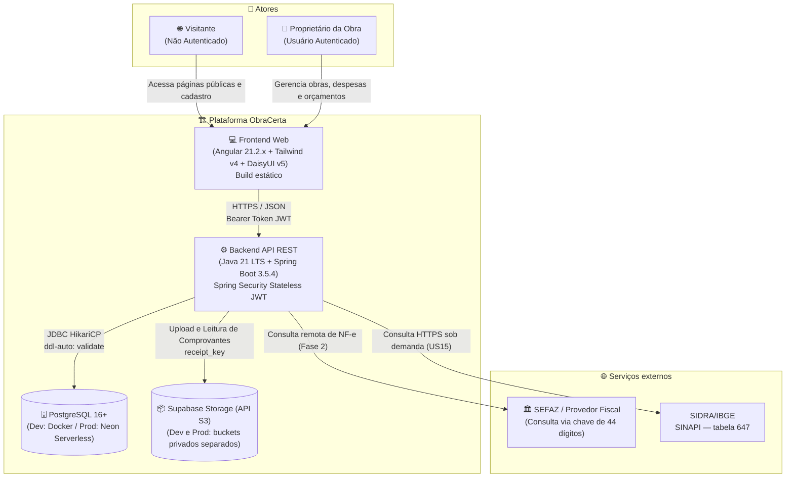
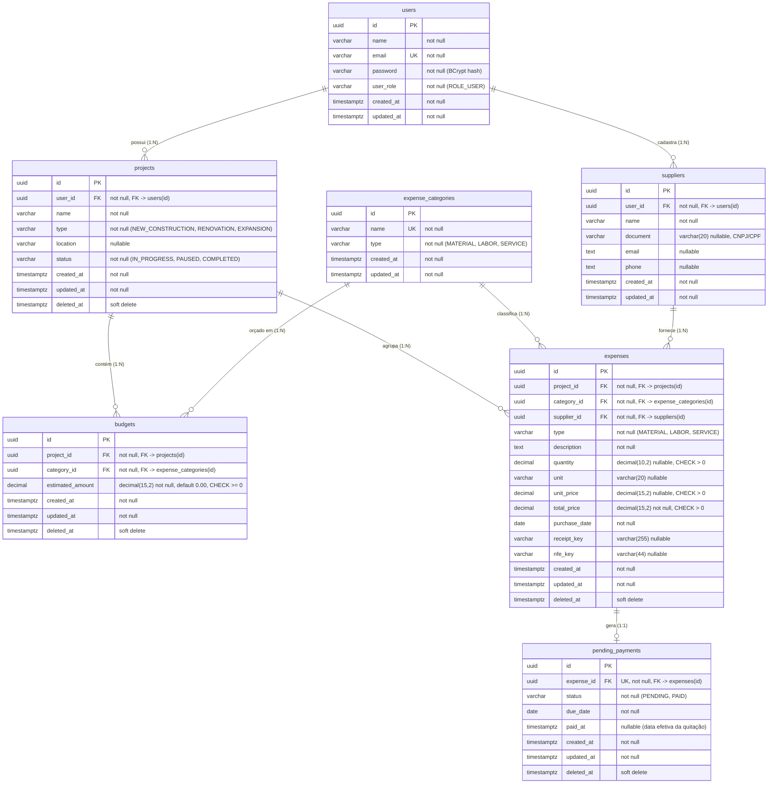
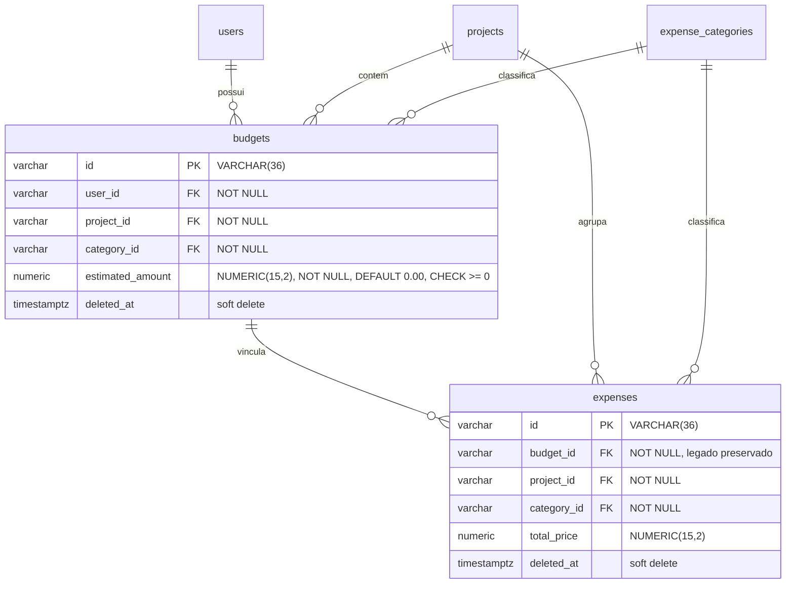
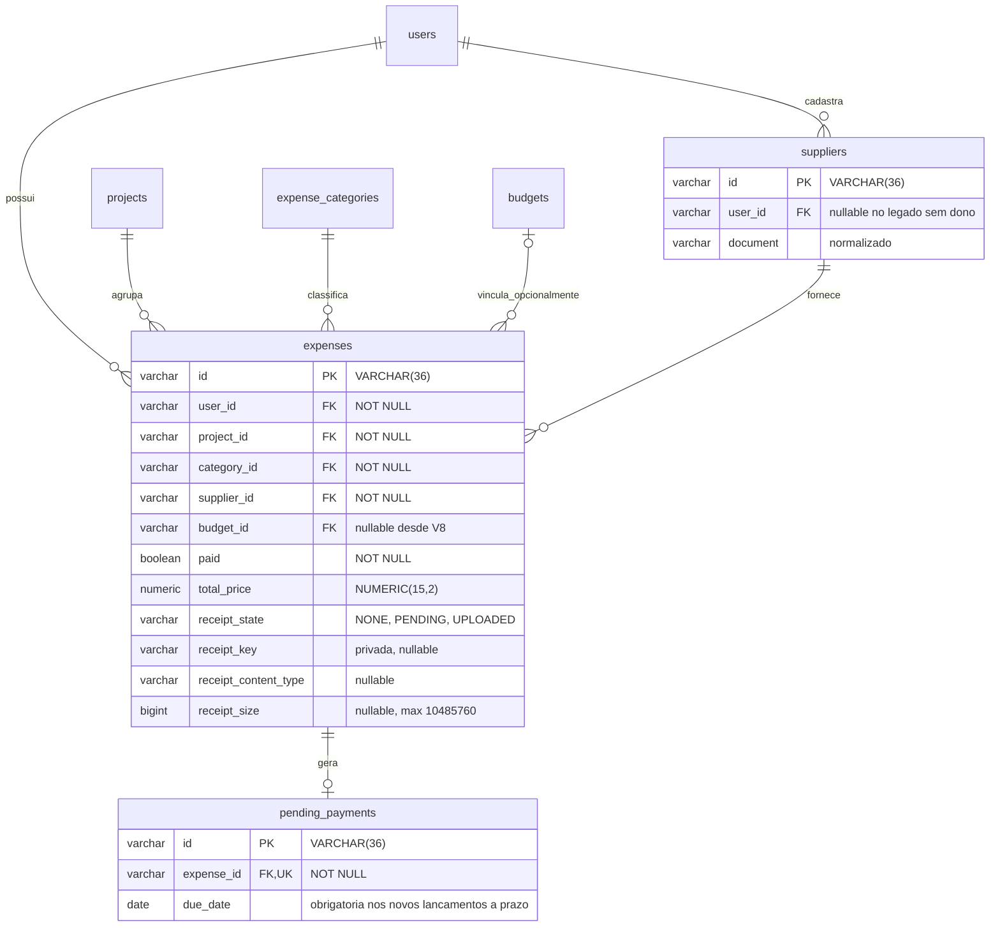
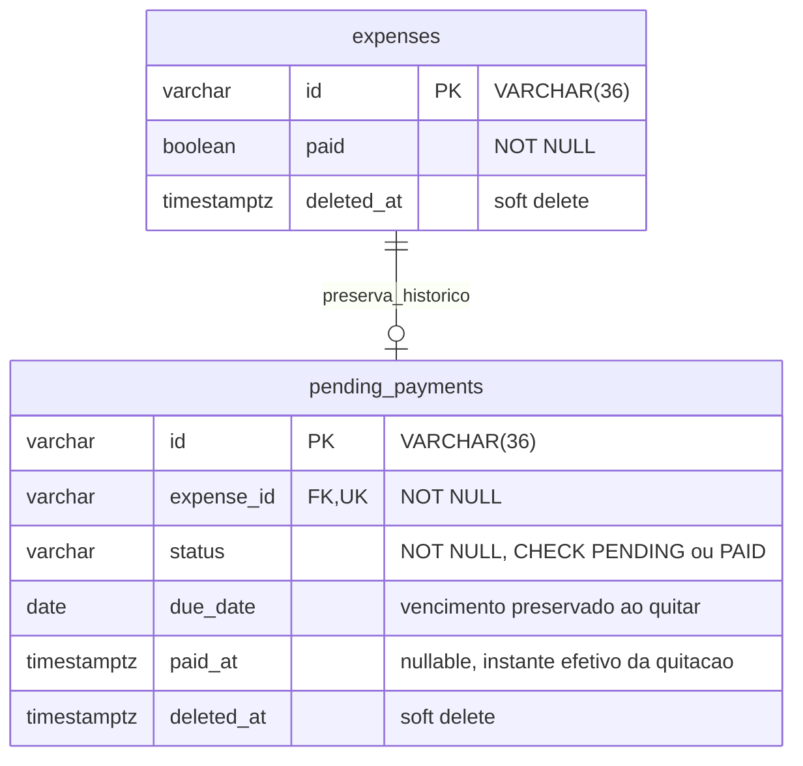
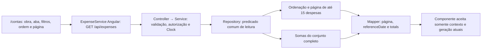
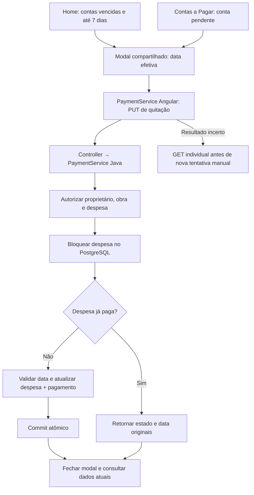

# 📐 Arquitetura do Sistema - ObraCerta!

**Projeto:** ObraCerta (Gestão Financeira de Obras Residenciais)  
**Status do Documento:** 🟢 Definido (Fase 0 - SDD)  
**Versão:** 2.0.0 (Normatizada para o Método UTF-SDD)  
**Última Atualização:** 2026-10-26 (fechamento da implementação da US07)

---

## 🏗️ 1. Estrutura do Monorepo

O projeto adota a arquitetura de **Monorepo**, centralizando a aplicação client (SPA), a API de serviços backend, documentações vivas e especificações de engenharia:

```
obra-certa/
├── .github/
│   └── workflows/
│       └── ci.yml                         # CI atual: testes backend com PostgreSQL de serviço, testes e build frontend
│
├── apps/
│   ├── web/                               # Frontend em Angular 21.2.x
│   │   ├── src/
│   │   │   ├── app/
│   │   │   │   ├── core/                  # Serviços singleton, infraestrutura e segurança
│   │   │   │   │   ├── guards/            # authGuard (proteção de rotas privadas)
│   │   │   │   │   ├── interceptors/      # authInterceptor (JWT; logout e redirecionamento em 401)
│   │   │   │   │   ├── models/            # Interfaces e types TypeScript (espelho dos DTOs)
│   │   │   │   │   └── services/          # Camada única de comunicação HTTP com a API
│   │   │   │   │       ├── auth.ts
│   │   │   │   │       ├── active-project.service.ts  # Signal reativo com persistência em localStorage
│   │   │   │   │       ├── project.service.ts
│   │   │   │   │       ├── expense.service.ts
│   │   │   │   │       ├── budget.service.ts
│   │   │   │   │       ├── category.service.ts
│   │   │   │   │       └── supplier.service.ts
│   │   │   │   ├── shared/                # Componentes puros, pipes e utilitários globais
│   │   │   │   │   ├── components/        # Navbar, Sidebar, KpiCard, RadialGauge, CategoryProgressCard,
│   │   │   │   │   │                      # AlertBanner, StatusBadge, ConfirmModal, EmptyState, ProjectModal
│   │   │   │   │   └── pipes/             # CurrencyBrlPipe, DateBrlPipe
│   │   │   │   └── features/              # Módulos de telas organizados por domínio de negócio
│   │   │   │       ├── auth/              # Login e Cadastro (Register)
│   │   │   │       ├── projects/          # Criação, Edição e Gestão de Obras (US14)
│   │   │   │       ├── dashboard/         # Home com KPIs, gráficos e painel de alertas
│   │   │   │       ├── expenses/          # Listagem paginada, filtros, formulário e modal de NF-e
│   │   │   │       ├── budgets-page/      # Painel de orçamentos e modal de criação/edição (US07)
│   │   │   │       └── reports/           # Relatórios comparativos e exportação de PDF
│   │   │   ├── assets/                    # Ícones SVG, manifest.webmanifest e imagens
│   │   │   └── styles.css                 # Importação do Tailwind v4, DaisyUI v5 e tokens
│   │   ├── Dockerfile                     # Build multi-stage gerando imagem estática Nginx
│   │   ├── nginx.conf                     # Configuração do Nginx com fallback SPA e proxy /api
│   │   ├── package.json                   # Dependências e scripts de teste (Jasmine/Karma)
│   │   └── tsconfig.json                  # strict: true, strictTemplates: true
│   │
│   └── api/                               # Backend RESTful em Java 21 LTS / Spring Boot 3.5.4
│       ├── src/
│       │   ├── main/
│       │   │   ├── java/com/obracerta/
│       │   │   │   ├── configuration/     # SecurityConfig, CorsConfig, OpenApiConfig, ClockConfiguration
│       │   │   │   ├── controller/        # Controladores REST magros com Bean Validation (@Valid)
│       │   │   │   ├── service/           # Regras de negócio, cálculos, travas orçamentárias e Anti-IDOR
│       │   │   │   ├── repository/        # Spring Data JPA com queries de posse por usuário
│       │   │   │   ├── mapper/            # Conversão Entity ↔ DTO e envelopamento PageResponse<T>
│       │   │   │   ├── model/
│       │   │   │   │   ├── dto/           # Java Records imutáveis para entrada e saída de dados
│       │   │   │   │   └── entity/        # Entidades JPA; tipos físicos definidos pelas migrations
│       │   │   │   ├── security/          # TokenService (JWT), SecurityFilter e UserContextHelper
│       │   │   │   ├── integration/       # Parser de XML de NF-e
│       │   │   │   ├── exception/         # RestControllerAdvice e hierarquia de exceções de negócio
│       │   │   │   └── enums/             # ProjectType, ProjectStatus, BudgetState e enums de despesas
│       │   │   └── resources/
│       │   │       ├── db/migration/      # Migrations versionadas e imutáveis do Flyway (V1, V2...)
│       │   │       ├── application.properties       # Propriedades gerais
│       │   │       ├── application-dev.properties   # Perfil de desenvolvimento (Postgres Docker)
│       │   │       ├── application-test.properties  # PostgreSQL fornecido por ambiente/serviço de CI
│       │   │       └── application-prod.properties  # Perfil de produção (Neon Serverless)
│       │   └── test/                      # JUnit 5, Mockito e integração com PostgreSQL
│       ├── Dockerfile                     # Empacotamento em container OCI da aplicação Spring Boot
│       └── pom.xml                        # Maven, Spring Boot, Flyway e dependências de teste
│
├── docs/                                  # Documentação Viva (Fase 0 - SDD)
│   ├── prd.md                             # Requisitos, Histórias e Regras de Negócio
│   ├── design-tokens.md                   # Tokens visuais, Breakpoints, PWA e Desistência
│   ├── architecture.md                    # Arquitetura Técnica do Sistema (este documento)
│   └── user-flows.md                      # Diagramas de Jornadas e Mitigações
│
├── specs/                                 # Especificações por Issue (Ordem de Serviço do SDD)
├── docker-compose.yml                     # PostgreSQL, backend e frontend; storage externo no Supabase
├── .env.example                           # Template de variáveis de ambiente sem segredos
└── README.md                              # Guia de início rápido e visão geral do projeto
```

---

## 🌐 2. Diagrama de Contexto do Sistema



---

## 🗄️ 3. Modelo de Dados (MER Consolidado)

O schema físico do PostgreSQL é versionado pelo **Flyway**. O MER consolidado abaixo é o modelo lógico alvo, incluindo atributos de histórias ainda não implementadas; não substitui as migrations. No schema versionado desta entrega (V1-V13), os identificadores UUID são armazenados em `VARCHAR(36)`, valores monetários usam `NUMERIC(15,2)` e os tipos temporais seguem cada migration. A notação `uuid` do modelo lógico não implica uma conversão física já aplicada. Os recortes por história abaixo documentam a evolução implementada.



### Persistência implementada na US07 (V6–V7, antes da US03)

- A V6 normaliza valores nulos para `0.00`, define `NOT NULL`, `DEFAULT 0.00` e `CHECK (estimated_amount >= 0)`. Antes de criar o índice único ativo por obra/categoria, exclui logicamente duplicatas, preservando a mais recente e os vínculos das despesas.
- A V7 insere as nove categorias pré-definidas somente quando seus nomes ainda não existem. A aplicação consulta essas categorias no banco.
- Na entrega da US07, `expenses.budget_id` permanecia obrigatório no schema legado. Despesas sem teto eram representadas por orçamento zerado; a leitura também suporta despesa sem orçamento ativo, como quando o registro vinculado está excluído logicamente. A US03 flexibiliza esse vínculo na V8.
- Neste recorte do MER, as colunas mostram os vínculos e valores usados pelo orçamento; os demais atributos permanecem definidos nas migrations.



### Persistência implementada na US03 (V8–V9)

- **V8:** torna `expenses.budget_id` opcional e acrescenta `paid`. Despesa sem teto não exige orçamento artificial; despesa a prazo gera pagamento pendente na mesma transação. Fornecedores recebem `user_id`; o backfill clona fornecedores compartilhados por contas e religa as despesas. Fornecedores legados sem referência permanecem sem proprietário e não são expostos na seleção.
- **V9:** persiste `receipt_state` (`NONE`, `PENDING`, `UPLOADED`), chave privada, tipo e tamanho. A constraint exige ausência de metadados em `NONE/PENDING` e metadados completos em `UPLOADED`. `receipt_url` legado é mantido para auditoria, sem presumir que exista arquivo confirmado.
- A entrega termina na tarefa 8. Não inclui tabela de idempotência nem recuperação de rascunho após sessão expirada. O recorte abaixo destaca as relações e colunas afetadas; o restante do schema continua nas migrations.



### Persistência implementada na US04 (V10)

- A V10 acrescenta `pending_payments.status` (`PENDING` ou `PAID`, obrigatório) e `paid_at` (instante de quitação, nulo quando desconhecido). O backfill usa `expenses.paid`; pagamentos sem despesa correspondente recebem `PENDING`. As migrations já aplicadas permanecem imutáveis e Hibernate continua em `validate`.
- A edição da despesa e do pagamento é atômica. Paga → pendente exige vencimento válido, reutiliza o pagamento existente e limpa `paid_at`; pendente → paga registra o instante pelo `Clock` injetado. Paga → paga preserva a data anterior, inclusive nulo legado. A unicidade de `expense_id` impede duplicação de pagamentos.
- A exclusão lógica preserva os registros financeiros, incluindo pagamentos quitados, com o mesmo instante em `expenses.deleted_at` e `pending_payments.deleted_at`. Os agregados já ignoram despesas excluídas e não alteram o teto.



### Constraints e Índices Especiais no PostgreSQL:
O índice de orçamento do item 1 está implementado pela V6. Os demais itens descrevem a evolução do modelo; sua aplicação física deve ser conferida nas migrations da respectiva história.
1. **Índice Único Parcial para Orçamento Único por Categoria:**
   `CREATE UNIQUE INDEX idx_budgets_project_category_active ON budgets (project_id, category_id) WHERE deleted_at IS NULL;`
2. **Unicidade da Chave de NF-e na Obra (sem índice único):** a chave é verificada na aplicação, com a trava `SELECT … FOR UPDATE` sobre a linha da obra (`ProjectRepository`, `NfeKeyGuard`). Linhas ativas são as de `deleted_at IS NULL`. Não há índice único parcial para `nfe_key`; a decisão está registrada em `specs/11-importacao-despesas-nfe/plan.md`.
3. **Índice Único Parcial para Fornecedor por Usuário:**
   `CREATE UNIQUE INDEX idx_suppliers_user_document_active ON suppliers (user_id, document) WHERE document IS NOT NULL;`
4. **Índices de Performance para Filtros e Painéis:**
   - `CREATE INDEX idx_expenses_project_date ON expenses (project_id, purchase_date) WHERE deleted_at IS NULL;`
   - `CREATE INDEX idx_expenses_project_category ON expenses (project_id, category_id) WHERE deleted_at IS NULL;`
   - `CREATE INDEX idx_payments_status_due ON pending_payments (status, due_date) WHERE deleted_at IS NULL;`

---

## 📖 4. Glossário Técnico (Mapeamento PT-BR ➔ EN)

| Conceito de Negócio (PT-BR) | Entidade JPA / DTO (EN) | Tabela PostgreSQL | Coleção / Rota API |
| :--- | :--- | :--- | :--- |
| **Usuário** | `User` / `RegisterUserDTO`, `AuthDTO` | `users` | `/api/auth` |
| **Obra (Projeto)** | `Project` / `ProjectDTO` | `projects` | `/api/projects` |
| **Categoria de Despesa** | `ExpenseCategory` / `CategoryResponseDTO` | `expense_categories` | `/api/expense-categories` |
| **Fornecedor** | `Supplier` / `SupplierDTO` | `suppliers` | `/api/suppliers` |
| **Orçamento Previsto** | `Budget` / `BudgetSetDTO`, `BudgetCategoryDTO`, `BudgetOverviewDTO` | `budgets` | `/api/budgets` |
| **Despesa (Gasto Real)** | `Expense` / `ExpenseCreateDTO`, `ExpenseResponseDTO` | `expenses` | `/api/expenses` |
| **Pagamento Pendente** | `PendingPayment` / `PaymentDTO` | `pending_payments` | `/api/pending-payments` |

---

## 🏛️ 5. Padrões Arquiteturais

### 5.1 Frontend (Angular 21.2.x)

0. **SPA, sem SSR nem prerender:** Todas as telas úteis ficam atrás do login, e o token JWT vive no `localStorage`, que não existe no servidor. Renderizar no servidor não traz ganho de SEO nem de primeira pintura e fazia o `authGuard` redirecionar para o login toda recarga ou link direto de rota autenticada. O build gera apenas `dist/frontend/browser/index.html` com os bundles, servido pelo Nginx com fallback para o `index.html`.
1. **Componentes Standalone:** Padrão moderno desprovido de `NgModule`.
2. **Gerenciamento de Estado Reativo com Signals:** Utilização de `signal()`, `computed()` e `effect()` para gerenciar o estado reativo das telas e componentes.
3. **Controle de Fluxo Moderno:** Adoção estrita de `@if`, `@for`, `@switch` no lugar de diretivas legadas (`*ngIf`, `*ngFor`).
4. **Formulários:** Uso de `ReactiveFormsModule` com validação de consistência temporal e tipagem forte.
5. **Injeção de Dependências:** Uso exclusivo da função `inject()`.
6. **Estado da Obra Ativa (`ActiveProjectService`):** O projeto ativo selecionado reside em um Signal global no `ActiveProjectService`, com persistência automática no `localStorage`. Todas as telas e componentes consomem esse estado reativo, eliminando seletores locais redundantes.
7. **Regra de Ouro da Camada de Dados:**
   - Nenhum componente acessa o `HttpClient` diretamente;
   - Todas as requisições passam obrigatoriamente por serviços em `core/services/`;
   - Retornos fortemente tipados via `Observable<T>` (proibido uso de `any`);
   - `authInterceptor` anexa o JWT, encerra a sessão no `401` e propaga o erro. Falhas de rede/5xx e erros de domínio chegam aos componentes para feedback e nova tentativa, sem transformar falha em sucesso.

8. **Painel de orçamento (US07):** a recarga automática observa o identificador da obra, não a referência do objeto. Atualizar a lista da navbar ou os metadados da mesma obra não recarrega orçamento/categorias nem descarta diálogos. Troca real de obra fecha os diálogos, limpa o contexto e ignora respostas antigas, inclusive no ciclo A → B → A.
9. **Valor monetário no formulário:** máscara local BRL interpreta os dígitos como centavos (`123456` → `R$ 1.234,56`), mantendo o controle e o DTO numéricos em reais (`1234.56`). Valores existentes são formatados sem nova divisão por cem. Vazio e zero continuam inválidos no formulário; zerar exige a confirmação explícita.
10. **Sessão e recuperação:** `/` e `/login` abrem o mesmo Login; `Auth.logout()` remove token e obra ativa antes de navegar para `/login`. Erros preservam formulário ou confirmação e reabilitam nova tentativa. Uma resposta perdida não prova que o servidor deixou de gravar.
11. **Contexto das despesas (US03):** `ActiveProjectService` expõe signals somente para leitura e uma versão de contexto que muda sincronamente ao trocar o identificador da obra. Formulário e consulta limpam o contexto anterior e ignoram respostas antigas, inclusive A → B → A. Atualizar metadados da mesma obra não descarta os campos. O cadastro não restaura rascunho após novo login; `401` mantém o encerramento da sessão existente.

### 5.2 Backend (Java 21 LTS / Spring Boot 3.5.4)

1. **Arquitetura em Camadas com Sentido Único:**
   - `Controller` ➔ `Service` ➔ `Repository` ➔ `Entity`.
   - **Controllers são magros:** apenas recebem, validam via `@Valid`, delegam ao service e retornam DTOs com o status HTTP correspondente. **É proibido injetar Repositories em Controllers**.
   - **Services concentram 100% da lógica:** cálculos, validações de teto orçamentário, checagens de datas e validações de Anti-IDOR.
2. **Fronteira com DTOs em Java Records:**
   - Entidades JPA nunca atravessam a camada de Controller. A conversão é feita na camada `mapper/` de forma explícita e tipada.
   - No agregado financeiro da US07, o `BudgetService` compõe `BudgetCategoryDTO` e `BudgetOverviewDTO` a partir dos orçamentos e das projeções de despesas, junto aos cálculos. A API continua expondo somente records, nunca entidades JPA.
3. **Formato Único de Erro (`@RestControllerAdvice`):**
   - Todas as falhas devolvem um payload estruturado e padronizado:
   ```json
   {
     "timestamp": "2026-10-15T20:00:00Z",
     "status": 409,
     "error": "Conflict",
     "message": "O orçamento não pode ser menor do que o total de despesas já realizadas nesta categoria: R$ 5.000,00",
     "path": "/api/budgets/3fa85f64-5717-4562-b3fc-2c963f66afa6/categories/categoria-id",
     "fieldErrors": []
   }
   ```
   - **Semântica de Códigos HTTP:**
     - `400 Bad Request`: falhas de validação de payload (`@Valid`), campos faltantes ou inválidos;
     - `401 Unauthorized`: ausência de autenticação válida, incluindo JWT ausente, inválido ou expirado. A cadeia do Spring Security deve devolver 401 para acionar o encerramento de sessão no frontend;
     - `403 Forbidden`: usuário autenticado sem a permissão exigida pela rota;
     - `404 Not Found`: recurso não localizado ou tentativa de acesso a dados de terceiros (Anti-IDOR);
     - `409 Conflict`: violação de regra de negócio de estado existente (RN02 de orçamento ou violações de unicidade de banco);
     - `500 Internal Server Error`: erro interno genérico não mapeado, omitindo stack traces do cliente.
4. **Relógio Injetável (`java.time.Clock`):**
   - Classes de serviço que operam sobre datas (validação de vencimento e horizonte de 7 dias) injetam `Clock`, permitindo fixar instantes temporais em testes com `Clock.fixed()`.

---

## 📡 6. Contrato e Convenções de API

1. **Prefixos e Verbos:**
   - Prefixo obrigatório: `/api/`;
   - Recursos no plural, em inglês e kebab-case (`/api/projects`, `/api/expenses`, `/api/expense-categories`, `/api/budgets`);
   - Métodos semânticos: `POST` de criação retorna `201 Created` com header `Location`; `GET` retorna `200 OK`; `PUT`/`PATCH` retorna `200 OK`; `DELETE` retorna `204 No Content` no primeiro e `404 Not Found` em repetições, salvo os contratos com resultado explícito da US04 abaixo. A ação `POST .../zero` da US07 retorna `200 OK` com o orçamento recalculado, pois atualiza um registro existente.
2. **Paginação de despesas com totais agregados (`ExpensePageResponseDTO`):**
   - A US05 retorna registros paginados e o objeto `totals`, calculado sobre o conjunto inteiro da consulta:
   ```json
   {
     "content": [ /* lista de DTOs da página */ ],
     "page": 0,
     "size": 15,
     "totalElements": 45,
     "totalPages": 3,
     "last": false,
     "referenceDate": "2026-11-01",
     "totals": {
       "totalPaid": 12500.00,
       "totalPending": 3400.00,
       "totalGeneral": 15900.00
     }
   }
   ```
   - A listagem de despesas valida `page >= 0` e `size` entre 1 e 15, com padrão 15. O limite genérico de Spring Pageable não substitui essa validação do endpoint.
   - Listas pequenas, como categorias, retornam `List<T>` com `200 OK`. O painel de orçamento retorna um objeto `BudgetOverviewDTO`, contendo totais e a lista `categories`.
3. **Escopo por Obra:**
   - Consultas de coleções filtram via query parameter obrigatório: `?projectId=<uuid>`.
   - Leituras agregadas da obra residem sob `GET /api/projects/{id}/reports`; a exportação visual usa `GET /api/projects/{id}/reports/export`, e o PDF legado permanece em `GET /api/projects/{id}/reports/pdf`.
4. **Documentação OpenAPI / Swagger:**
   - Habilitado em desenvolvimento sob `/swagger-ui.html` e `/v3/api-docs` com esquema de segurança `bearerAuth` configurado para permitir testes diretos no navegador;
   - Desabilitado no perfil de produção (`springdoc.swagger-ui.enabled=false`).

### Contrato implementado da US06 — relatórios

- `GET /api/projects/{id}/reports`: JSON com identificação, totais previsto/realizado/pago/a pagar e consolidação por categoria. Aceita `from` e `to` opcionais em ISO (`LocalDate`); limita despesas por `purchaseDate` inclusiva e mantém o orçamento integral. Intervalo invertido retorna `400`.
- `GET /api/projects/{id}/reports/export`: snapshot JSON autorizado com `report`, `filename`, `generatedAt`, `from`, `to` e `categoryName`. Aceita também `category`; os totais e valores de quitação refletem a categoria selecionada. A leitura usa uma transação `REPEATABLE_READ` e a resposta recebe `Cache-Control: no-store`.
- `GET /api/projects/{id}/reports/pdf`: contrato legado `application/pdf` com consolidado e despesas individuais, gerado por Apache PDFBox 3.0.8. Não recebe os filtros da exportação visual. Nome de arquivo e data de geração são definidos no servidor com `Clock`.
- `ReportController` delega a `ReportService`, que valida posse antes das consultas financeiras e usa `BigDecimal`. Consultas excluem despesas e orçamentos removidos logicamente; obra inexistente, excluída ou alheia retorna `404`. Categorias sem orçamento participam dos gastos, mas não do comparativo de tetos. Nenhuma migration foi necessária para a US06.
- No Angular, `/relatorios` usa o layout autenticado e `core/services/report.service.ts`. Datas digitadas em Reactive Forms são separadas das aplicadas; limpar restaura o histórico e trocar de obra restaura o período vazio. Signals alimentam a apresentação compartilhada da tela e do PDF.
- `ReportVisualExportService` carrega `html-to-image` 1.11.13 e `pdf-lib` 1.17.1 sob demanda, captura a apresentação isolada em composição desktop a 2x e pagina o PDF visual sem navegação, controles ou apêndice. O snapshot autorizado fornece período, categoria, nome e data, preservando os filtros da tela. A exportação mantém somente estado transitório, impede duplicidade e descarta trabalho abandonado ao mudar obra, filtros ou página, inclusive após etapas assíncronas locais. Em falha, apresenta apenas um erro, sem retry automático ou ação específica de nova tentativa.

### Contrato implementado da US05 — listagem de despesas

`GET /api/expenses` é autenticado e retorna `200`, `ExpensePageResponseDTO`: `content`, `page`, `size`, `totalElements`, `totalPages`, `last`, `referenceDate` e `totals`. Os itens de `content` reutilizam `ExpenseResponseDTO`. Não houve alteração de schema ou migration nesta história.

| Parâmetro | Contrato implementado |
| --- | --- |
| `projectId` | UUID obrigatório de obra própria e ativa; obra inexistente, excluída ou alheia retorna 404. |
| `page`, `size` | Página a partir de zero; tamanho de 1 a 15, padrão 15. |
| `tab` | `ALL` (padrão), `PENDING`, `OVERDUE` ou `PAID`. Pendentes inclui vencidas. Vencidas exige despesa não quitada e pagamento ativo com vencimento anterior à referência; vencimento nulo ou no dia não é atraso. |
| `purchaseDateFrom`, `purchaseDateTo` | Datas ISO `YYYY-MM-DD`, limites inclusivos; permitem intervalo aberto. |
| `dueDateFrom`, `dueDateTo` | Mesmo formato e inclusão dos limites; quando presentes, excluem registros sem vencimento ativo correspondente. |
| `categoryIds` | Parâmetro repetido para selecionar uma ou mais categorias existentes. |
| `supplierId` | UUID de fornecedor autorizado ao usuário; inexistente ou alheio retorna 404. O catálogo global da US15 permanece futuro. |
| `sort` | `PURCHASE_DATE_DESC` (padrão), `PURCHASE_DATE_ASC`, `AMOUNT_DESC` ou `AMOUNT_ASC`; desempate sempre por `id` crescente. |

- Nome desconhecido, valor vazio, repetição de parâmetro simples, data/UUID/enum inválido, categoria inexistente, paginação inválida ou intervalo invertido retorna 400 no formato `ApiErrorResponse`.
- O service converte os parâmetros em `ExpenseListQueryDTO`, autoriza a obra e as referências e calcula uma única `referenceDate` com `Clock` no fuso de negócio `America/Sao_Paulo` (`ClockConfiguration.BUSINESS_ZONE`), para que a virada do dia siga o horário de Brasília. O repository compartilha os mesmos predicados entre página e agregação: proprietário, obra ativa, despesas ativas, aba e filtros combinados. A ordenação acontece antes da paginação; `totals` não depende da página. `totalGeneral = totalPaid + totalPending`, com `BigDecimal` na API.
- A consulta é somente leitura e não acessa comprovantes no storage. Despesas pagas sem `PendingPayment` permanecem na listagem. O MER e os diagramas gerais de persistência permanecem válidos; o fluxo abaixo documenta a nova leitura.



- `/contas` oferece quatro abas, formulário de filtros, ordenação, três totalizadores em BRL, tabela desktop e cards mobile. Os links de cada registro reutilizam `/despesas/:id`; cadastro permanece em `/contas/nova`. Sem obra ativa, a tela orienta seleção sem consultar despesas.
- `ActiveProjectService.contextVersion` identifica transições reais de obra, inclusive A → B → A; atualizar metadados da mesma obra preserva a seleção. Cada GET recebe uma geração própria, validada no sucesso e no erro junto da versão da obra e do ciclo de vida do componente. Trocar obra limpa filtros/aba/ordem/página; trocar aba/filtros/ordem retorna à primeira página. Intervalo inválido bloqueia HTTP, descarta resultados antigos e encerra o carregamento.
- Falhas retiram registros e totais antigos e oferecem nova tentativa manual no contexto solicitado. O interceptor existente trata 401, sem restauração de intenção após login. Retornar do cadastro ou consulta individual recria a listagem e consulta o estado atual; sair não altera os dados financeiros.

### Contrato implementado da US07

| Método e caminho | Retorno | Comportamento |
| --- | --- | --- |
| `GET /api/expense-categories` | `200`, `List<CategoryResponseDTO>` | Categorias do banco, ordenadas por nome em pt-BR. |
| `GET /api/budgets?projectId={id}` | `200`, `BudgetOverviewDTO` | Totais da obra e categorias com orçamento ativo ou despesas ativas. |
| `PUT /api/budgets/{projectId}/categories/{categoryId}` | `200`, `BudgetCategoryDTO` | Cria ou atualiza um único orçamento ativo; corpo `BudgetSetDTO` com `estimatedAmount`. |
| `POST /api/budgets/{projectId}/categories/{categoryId}/zero` | `200`, `BudgetCategoryDTO` | Grava `0.00` no registro ativo existente, sem apagá-lo; chamadas repetidas preservam o resultado. |

- Todas as operações de orçamento validam primeiro a obra do usuário autenticado. Obra inexistente ou alheia retorna `404 Projeto não encontrado`; nas escritas, categoria inexistente retorna `404 Categoria não encontrada`. Zeramento sem orçamento ativo retorna `404 Orçamento não encontrado`.
- O PUT exige valor positivo com até duas casas decimais (`400` se inválido); valor positivo inferior ao gasto ativo da categoria gera `409` sem alterar o registro. Igualdade com o gasto é aceita.
- Os cálculos somam apenas despesas com `deleted_at IS NULL`, incluindo pagas e pendentes. Saldo pode ser negativo; percentual é nulo quando o teto é zero, evitando divisão por zero.
- `BudgetState`: `ON_TRACK` abaixo de 90%, `WARNING` de 90% até abaixo de 100%, `EXCEEDED` a partir de 100% e `NO_BUDGET` quando o teto é zero. O estado usa a razão exata; o percentual exibido é arredondado para uma casa decimal. `hasBudget` informa a existência do registro ativo, mesmo zerado.
- `BudgetOverviewDTO` reúne `projectId`, `totalPlanned`, `totalSpent`, `available`, `globalPercentage`, `exceededCategories`, `budgetedCategories` e `categories`. Cada `BudgetCategoryDTO` informa categoria, planejado, gasto, saldo, percentual, estado e `hasBudget`.

### Contrato implementado da US15 — orçamento por categoria a partir do SINAPI

| Rota | Entrada | Resposta de sucesso |
| --- | --- | --- |
| `GET /api/budgets/{projectId}/sinapi/availability` | `uf` e `year` (`AAAA`) | `200 OK`, `SinapiAvailabilityDTO` com os 12 meses (`AAAA-MM`) e os IDs de projetos com pelo menos um acabamento válido por mês. |
| `GET /api/budgets/{projectId}/sinapi/references` | `uf`, `month` (`AAAA-MM`) e `projectType` | `200 OK`, `SinapiReferencesDTO` com fonte e acabamentos com custo positivo por m². Uma seleção válida sem dados retorna a lista vazia. |
| `POST /api/budgets/{projectId}/sinapi/confirm` | `SinapiConfirmDTO` com UF, mês, projeto, acabamento, área, custo unitário da prévia e percentuais por categoria | `200 OK`, `SinapiConfirmationDTO` com os tetos criados e as categorias preservadas entre as parcelas positivas. |

- `SinapiReferenceService` verifica a titularidade da obra e `SidraClient` consulta a tabela 647, variável 51, com as classificações 314 (projeto) e 41 (acabamento). O cliente valida o cabeçalho e as dimensões da resposta. Os limites de conexão e leitura são de cinco segundos cada. O `BudgetService` do Angular aplica um limite de quinze segundos à consulta de referências.
- O cliente consulta diretamente `apisidra.ibge.gov.br`. A disponibilidade anual consulta os oito projetos em lote e usa a mesma validação da consulta de acabamentos, incluindo nome e preço positivo. O formulário desabilita meses sem projetos válidos e projetos sem acabamento disponível no mês selecionado. Uma troca de UF ou ano invalida as seleções dependentes e descarta respostas antigas. Em caso de falha, o formulário oferece uma nova tentativa.
- A API retorna `400` para entradas inválidas, `404` para obra inacessível, `503` para falha ou resposta incompatível do SIDRA e `409` se o acabamento deixou de estar disponível ou o custo mudou entre a prévia e a confirmação. O `SinapiNoStoreConfiguration` aplica `Cache-Control: no-store` às respostas tratadas pelas rotas SINAPI, inclusive erros de validação.
- A confirmação valida a ordem das categorias conforme o PRD e recalcula o rateio em centavos. O total usa arredondamento `HALF_UP`. Os centavos restantes vão para as maiores frações, com desempate pela ordem das categorias no PRD. A referência é reconsultada antes da transação de gravação.
- A transação preserva tetos ativos, inclusive zerados, e insere apenas parcelas positivas sem teto ativo. O `ON CONFLICT DO NOTHING` usa o índice único parcial existente por obra e categoria para preservar um teto gravado concorrentemente. Uma falha de gravação reverte o lote. A US15 reutiliza `budgets` e as categorias existentes.
- Na página de Orçamentos, a aba SINAPI usa o catálogo completo da obra e mantém a consulta e o rateio em memória. Uma mudança de seleção invalida a prévia antiga. Durante a confirmação, o modal bloqueia o fechamento e a troca de aba por clique ou teclado. Após sucesso, a página recarrega os tetos. Após falha, o formulário exibe o erro e libera a troca de aba.
- Os testes verificam o descarte da prévia e a ausência de dados da consulta e do cálculo no banco, no armazenamento persistente do navegador e nas mensagens de log capturadas. A confirmação persiste os novos tetos.
- O alerta de despesas sem teto oferece “Definir teto”. Os atalhos de despesas permanecem visíveis e desabilitados por contrato da spec 09, com a dependência informada no tooltip.

---

### Contrato implementado da US03

| Método e caminho | Retorno | Comportamento |
| --- | --- | --- |
| `GET /api/suppliers` | `200`, lista de fornecedores | Somente fornecedores do usuário autenticado. |
| `POST /api/expenses` | `201`, `ExpenseResponseDTO` e `Location` | Recebe `ExpenseCreateDTO`; seleciona fornecedor existente ou cria inline. Grava despesa e eventual pagamento atomicamente. Sem contrato de idempotência neste recorte. |
| `GET /api/expenses/{id}` | `200`, `ExpenseResponseDTO` | Consulta individual com quitação, vencimento e estado de comprovante; não expõe URL pública do storage. |
| `PUT /api/expenses/{id}/receipt` | `200`, `ExpenseResponseDTO` | Multipart `file`, após despesa salva; falha não desfaz os registros financeiros. Reenvio atua sobre a mesma despesa. |
| `GET /api/expenses/{id}/receipt` | `200`, arquivo | Leitura autenticada, com nome seguro, `no-store` e `nosniff`. |

- Serviço valida obra ativa do proprietário, categoria e fornecedor. Leituras e upload recusam obra/despesa excluída; recurso alheio ou inexistente retorna `404`, antes de acessar storage.
- No cadastro inline, nome do fornecedor é obrigatório e CNPJ é opcional. A tela aplica máscara `00.000.000/0000-00`; a API valida 14 dígitos quando preenchido e normaliza a pontuação. Ausência de documento é persistida como `NULL` e não é usada para reutilizar fornecedores. A coluna já aceita nulo; nenhuma migration adicional é necessária.
- Modo direto exige total; modo calculado exige quantidade e valor unitário, calcula com `BigDecimal` e arredonda o total com `HALF_UP`. Pagamento a prazo exige vencimento igual ou posterior à compra. Gastos continuam no agregado da US07; alertas de teto ausente ou consumo de pelo menos 100% não bloqueiam a gravação.
- Comprovantes: MIME declarado e extensão correspondente JPEG/PNG/PDF; arquivo não vazio e até 10 MiB (10 × 1024 × 1024 bytes). Sem inspeção de bytes, decodificação de imagens ou biblioteca de PDF. Tipo inválido retorna `400`; tamanho excedido, `413`.
- Apenas sucesso do Supabase confirma `UPLOADED`. A consulta exibe “Sem comprovante” sem arquivo confirmado; falha de envio preserva despesa e pagamento e oferece reenvio posterior. Substituição/remoção de arquivo confirmado são entregues pela US04 abaixo; a listagem completa é entregue pela US05, na seção própria abaixo.
- Entrada: `/contas` → “Cadastrar conta” → `/contas/nova`; consulta individual em `/despesas/:id`.

---

### Contrato implementado da US04

| Método e caminho | Retorno | Comportamento |
| --- | --- | --- |
| `PUT /api/expenses/{id}` | `200`, `ExpenseResponseDTO` | Edita descrição, compra, categoria, valores e pagamento na mesma despesa; obra e fornecedor não são transferidos. |
| `DELETE /api/expenses/{id}` | `200`, `ExpenseDeleteResponseDTO` | Exclui financeiramente e retorna `receiptDeletionFailed`, distinguindo sucesso financeiro de falha ao apagar o comprovante. Nova mutação ou consulta da despesa excluída retorna `404`. |
| `DELETE /api/expenses/{id}/receipt` | `200`, `ExpenseResponseDTO` | Remove primeiro o arquivo, depois limpa estado/metadados; arquivo já ausente é aceito. Falha mantém erro e tentativa manual, sem limpeza agendada. |
| `PUT /api/expenses/{id}/receipt` | `200`, `ExpenseResponseDTO` | Envia para nova chave UUID, confirma associação e somente depois tenta apagar o anterior. Falha de associação preserva o antigo e permite uma tentativa imediata de apagar o novo sem vínculo. |

- `ExpenseResponseDTO` acrescenta `paidAt` e `receiptDeletionFailed`. O último é resultado transitório da tentativa imediata de exclusão física, não pendência persistida; consultas posteriores o retornam falso. Nenhuma resposta anuncia arquivo apagado quando a tentativa falhou.
- Autorização antecede acesso ao armazenamento: despesa alheia, inexistente, excluída ou de obra excluída retorna `404`. Entradas inválidas retornam `400` sem gravação parcial; falhas de armazenamento ou persistência tratadas retornam `503`, conforme o caminho da operação. A exclusão financeira só é anunciada após seu commit.
- A consulta individual contém edição, confirmação de exclusão e comprovantes, com retorno para `/contas`. Cancelar, X e Escape antes de enviar não gravam; backdrop é inerte. Os controles bloqueiam envio repetido. A versão da obra protege A → B → A e a versão de consulta impede que um GET anterior reexiba despesa já excluída. Atualizar metadados da mesma obra preserva o formulário aberto.
- Em falha ou resposta perdida, a interface permite consultar o estado e tentar manualmente, sem reenvio automático. GET com `404` retira os dados indisponíveis sem afirmar que a exclusão foi confirmada. Os campos da edição são preservados enquanto o modal e o contexto continuam abertos.
- Em `401`, todas as mutações mantêm a cadeia de segurança e o interceptor existentes: logout, limpeza da obra e login. O usuário volta manualmente à despesa para tentar novamente; não há reautenticação inline nem restauração de intenção após login.
- A listagem da US05 está na seção própria acima; não há catálogo global US15 nem tabela/fila/agendamento de limpeza. Falhas na tentativa física podem deixar objetos no armazenamento, sem garantia de recuperação posterior.

### Contrato implementado da US09 — importação de despesas via NF-e (XML)

| Método e caminho | Retorno | Partes de `multipart/form-data` |
| --- | --- | --- |
| `POST /api/projects/{projectId}/nfe/preview` | `200`, `NfePreviewResponseDTO` | `file` com o XML. Extrai os dados para conferência sem gravar despesas. |
| `POST /api/projects/{projectId}/nfe/imports` | `201`, lista de `ExpenseResponseDTO` | `file` com o XML conferido, `items` como `application/json` no formato `{"items":[{"itemNumber":1,"categoryId":"<uuid>"}]}` e parte opcional `payment` como `application/json` no formato `{"paid":true}`. Se `payment` estiver ausente, usa o campo opcional homônimo dentro de `items`. Sem valor de `paid`, assume `true`. |

- A configuração multipart da API limita o arquivo a 10 MiB (10.485.760 bytes) e a requisição completa a 11 MiB (11.534.336 bytes). O proxy Nginx também limita o corpo da requisição a 11 MiB (`client_max_body_size 11m`).
- As migrações V12 e V13 guardam no PostgreSQL a chave do XML e a próxima tentativa de limpeza. A API registra a pendência antes do upload e a encerra na mesma transação que confirma a importação. Em caso de falha, tenta excluir o objeto sem depender do tipo da exceção. Uma exclusão bem-sucedida mantém a pendência para nova verificação, pois uma tentativa anterior do PUT ainda pode terminar. A reconciliação usa travas para preservar uploads ativos. Após uma exclusão periódica bem-sucedida, verifica novamente em um dia. Se o DELETE falhar, tenta novamente em dez minutos.
- XML inválido ou fora do formato NF-e retorna `400` com o motivo. Na conferência, a interface exibe o alerta e oferece o cadastro manual. Obra alheia, inexistente ou excluída retorna `404`. Chave já importada com linhas ativas na mesma obra retorna `409`.
- A confirmação grava uma despesa por item com a chave extraída do XML. Apenas a primeira linha (`nItem = 1`) recebe o registro de pagamento e o comprovante XML. O indicador `paid` da nota é replicado em todas as despesas do grupo.
- A migração `V11__allow_xml_nfe_receipt.sql` acrescenta `application/xml` e `text/xml` aos tipos aceitos pela constraint `chk_expense_receipt_state` em `UPLOADED`, preservando o intervalo de tamanho maior que zero e de até 10 MiB. A importação preserva `text/xml` quando informado e usa `application/xml` nos demais casos. O upload manual de comprovantes segue restrito a JPEG, PNG e PDF.

### Contrato implementado da US08 — alertas e quitação

Implementação local concluída em 04/11/2026. A auditoria final aprovou a versão com as correções da segunda rodada. Reutiliza o schema V10, sem nova migration, alteração de entidades ou mudança no MER. `Expense.paid`, `PendingPayment.status` e `PendingPayment.paidAt` continuam sendo os campos persistidos do ciclo de pagamento.

| Método e caminho | Retorno | Comportamento |
| --- | --- | --- |
| `GET /api/projects/{projectId}/payment-alerts` | `200`, `PaymentAlertsDTO` | Retorna `projectId`, `referenceDate`, `count`, `totalAmount` e `items`, sem paginação ou truncamento. Cada item informa `expenseId`, `description`, `purchaseDate`, `dueDate`, `totalPrice` e `urgency`. |
| `PUT /api/projects/{projectId}/expenses/{expenseId}/payment` | `200`, `ExpenseResponseDTO` | Recebe `PaymentSettlementRequestDTO` com `paymentDate` obrigatório em `yyyy-MM-dd`. Quita a despesa e o compromisso na mesma transação, preservando a primeira quitação nas repetições. |

- A consulta usa uma única referência UTC obtida de `Clock` e inclui todas as contas vencidas e as que vencem até referência + 7 dias, inclusive. Exclui despesas pagas, pagamentos com status diferente de `PENDING`, vencimentos nulos e obra, despesa ou pagamento excluídos. A ordenação é por vencimento crescente e identificador da despesa. Quantidade e soma com `BigDecimal` derivam dos mesmos itens.
- `urgency`: `OVERDUE` antes da referência; `DUE_SOON` entre referência e +3 dias; `REGULAR` de +4 até +7. A Home apresenta texto e cor correspondentes, resumo, lista, vazio positivo e erro com nova consulta manual.
- A escrita identifica o usuário autenticado, autoriza a obra e obtém um bloqueio pessimista da linha da despesa por consulta SQL escalar `FOR UPDATE OF e`. Somente depois carrega despesa e pagamento, evitando decidir com estado materializado antes do bloqueio. Confere exclusão do pagamento antes de tratar idempotência; despesa pendente sem compromisso não é quitada por esta ação. Recurso inexistente, alheio, fora da obra ou excluído retorna `404` sem escrita.
- Campo ausente, nulo ou formato de data inválido retorna `400`. Na transição de pendente para paga, a data não pode anteceder a compra; igualdade e datas futuras são aceitas. A data fornecida é convertida para início do dia UTC em `paid_at`; o status passa imediatamente para `PAID` e `Expense.paid` para verdadeiro. Vencimento, histórico e demais campos financeiros são preservados. Repetição sobre despesa já paga retorna o estado persistido sem sobrescrever sua data. O fluxo de edição completa da US04 continua com sua própria regra documentada acima.
- `PaymentService` concentra autorização, classificação e agregação; `PaymentMapper` monta os itens de alerta e `ExpenseMapper` a resposta da quitação. A transação abrange ambos os registros. Os testes de integração verificam concorrência com sessões PostgreSQL identificadas e espera real por bloqueios, rollback após falha de gravação e autenticação JWT.
- No Angular, `core/services/payment.service.ts` centraliza PUT, consulta de alertas e reconciliação pela leitura individual de `ExpenseService`, conferindo obra e despesa retornadas. As operações da US08 têm timeout de 30 segundos, sem repetição automática e preservando o interceptor de 401. O modal compartilhado em `shared/components/payment-modal/` usa formulário reativo, data sugerida igual ao maior valor entre referência UTC e compra, foco contido no diálogo e devolução ao acionador quando disponível. Cancelar, X e Escape fecham antes do envio; backdrop é inerte. Durante envio, confirmação e fechamento ficam bloqueados.
- Home e Contas a Pagar reutilizam o mesmo modal. Sucesso fecha o diálogo e consulta os dados novamente; na listagem, preserva filtros/ordenação e ajusta página vazia. Falha nessa atualização informa que a quitação foi confirmada e oferece nova consulta. No envio com resultado incerto, o fluxo exige consultar a despesa antes de nova tentativa manual; um marcador transitório de incerteza pode sobreviver ao fechamento do modal, sem salvar a data digitada ou reenviar a operação. Resposta Pago confirma o estado persistido; Pendente libera tentativa manual; falha mantém recuperação por consulta.
- A versão do contexto invalida seleção, diálogo e respostas antigas inclusive em A → B → A. Trocar de obra não promete desfazer uma transação enviada. `401` mantém logout, limpeza da obra e login, sem restauração da intenção. `shared/utils/civil-date.ts` compartilha a apresentação do dia civil entre Home e Contas a Pagar, sem deslocamento pelo fuso do navegador.



## 🛡️ 7. Segurança, Isolamento e Soft Delete

1. **Autenticação Stateless (JWT):**
   - Emissão de token assinado via HMAC256 com validade configurada (7 dias);
   - Transmissão no cabeçalho `Authorization: Bearer <token>`.
2. **Anti-IDOR Centralizado no Servidor:**
   - Em todas as operações de leitura, edição ou exclusão, os repositórios filtram por `project.user.id = :authUserId`;
   - Se o identificador referenciar recurso de outro usuário, o sistema responde com `404 Not Found` (não revelando a existência do dado).
3. **Anti-IDOR Cruzado de Referências:**
   - Ao vincular um `supplier_id` em uma despesa, o serviço valida que o fornecedor pertence ao mesmo usuário dono da obra.
4. **Política de Soft Delete e Integridade:**
   - Exclusão de obra marca `deleted_at = now()` em `projects` e propaga o carimbo para `budgets`, `expenses` e `pending_payments` filhos;
   - Exclusão de despesa marca o mesmo instante de `deleted_at` na despesa e no pagamento vinculado, preserva status e data de quitação e retira valores dos agregados ativos, sem alterar o teto. Depois do commit financeiro, tenta remover fisicamente o comprovante; falha nessa tentativa é informada e não desfaz a exclusão.
   - **Remoção isolada de comprovante — Tarefa 3 da US04 implementada:** solicitar primeiro a exclusão física e só depois retirar os metadados no PostgreSQL. Falha no storage mantém o vínculo para tentativa manual. Se o storage concluir e a gravação no banco falhar, retornar erro; repetição manual trata objeto ausente como sucesso e conclui a retirada do vínculo.
   - **Substituição e exclusão da despesa — US04 implementada:** tentam apagar a chave antiga somente depois de confirmar a mudança no banco. Falha ao apagar arquivo não desfaz a troca confirmada nem a exclusão financeira; a resposta informa a falha daquela tentativa. Não há tabela de trabalhos, fila, agendamento ou mecanismo de recuperação futura. `receiptDeletionFailed` é um resultado transitório da operação, não estado de limpeza persistido. A aplicação não garante remoção posterior de um objeto cuja exclusão falhou.

---

## ⚙️ 8. Ambientes e Persistência

| Configuração | Desenvolvimento (`dev`) | Testes e CI (`test`) | Produção (`prod`) |
| :--- | :--- | :--- | :--- |
| **Banco de Dados** | PostgreSQL 16+ via Docker Compose | PostgreSQL 16 fornecido pelo ambiente ou serviço da CI | Neon Serverless PostgreSQL |
| **Conexão** | `localhost:5432` | `SPRING_DATASOURCE_URL`, usuário e senha por ambiente | Pooling (`-pooler`) com `prepareThreshold=0` |
| **Flyway** | Executado na subida (`validate`) | Executado na subida (`validate`) | String direta (sem pooler) para advisory locks |
| **Comprovantes** | Supabase Storage S3; bucket privado de desenvolvimento, requer internet | Substituto controlado e HTTP local, sem conta real | Supabase Storage S3; bucket privado e credenciais exclusivos de produção |
| **Frontend** | Angular CLI (`localhost:4200`) | Jasmine/Karma com ChromeHeadless | Build estático; hospedagem conforme configuração de implantação |
| **Backend** | Spring Boot CLI (`localhost:8080`) | JUnit 5 + SpringBootTest | Container Docker gerenciado sob HTTPS |

- **Configuração de comprovantes:** `RECEIPT_STORAGE_*` no `.env` da raiz, preenchido manualmente. O Compose usa `env_file`; o Spring importa opcionalmente esse arquivo ao executar da raiz ou de `apps/api`. As chaves S3 ficam apenas no backend; como elas ignoram RLS, a API valida a posse antes de acessar objetos. PostgreSQL e autenticação JWT existentes são preservados. O roteiro de configuração e validação está em [supabase-storage.md](./supabase-storage.md). A inicialização financeira não depende de credenciais ou conexão com o storage.

- **Variáveis do perfil `prod`** (`application-prod.properties`). As obrigatórias não têm valor padrão: sem elas a aplicação se recusa a subir, em vez de subir com segredo previsível.
  - Obrigatórias: `SPRING_PROFILES_ACTIVE=prod`, `SPRING_DATASOURCE_URL`, `SPRING_DATASOURCE_USERNAME`, `SPRING_DATASOURCE_PASSWORD`, `JWT_SECRET` e `CORS_ALLOWED_ORIGINS` (origens do frontend separadas por vírgula).
  - Opcionais: `FLYWAY_URL` (string direta do Neon, sem pooler; padrão é a URL do banco), `DB_POOL_SIZE` (padrão 5), `PORT` (padrão 8080; o Render define sozinho), `RECEIPT_STORAGE_*` e `JAVA_TOOL_OPTIONS`.
  - Em produção, os logs vão só para o console, o seed de demonstração nunca roda e `show-sql` fica desligado.
  - A imagem do backend usa heap proporcional ao limite do container, coletor serial e JIT de nível 1. Medido com 512 MB e 0,1 de CPU (limites típicos de plano gratuito), a partida caiu de cerca de 110 s para 64 s.

- **Regra de Ouro das Migrações:**
  - `spring.jpa.hibernate.ddl-auto=validate` em todos os perfis;
  - Toda alteração de schema gera arquivo versionado `apps/api/src/main/resources/db/migration/V<N>__<descricao>.sql`;
  - Migrações commitadas são imutáveis; correções são feitas sempre para frente (`V<N+1>`);
  - As categorias de despesas pré-definidas são inseridas como dados mestres via migration do Flyway.

- **Demonstração da US07:** `DemoDataSeederRunner` existe somente no perfil `dev` e com `SEED_ENABLED=true`; fica desligado por padrão. Ele delega ao seeder idempotente de usuário/obra/orçamentos/despesas, permitindo demonstrar o painel sem depender de despesas cadastradas pelo usuário. Dados e credenciais de demonstração não são configuração de produção.

---

## 🧪 9. Estratégia de Testes e Qualidade

1. **Frontend (`apps/web`):**
   - **Framework atual:** Jasmine/Karma, configurado em `apps/web/angular.json`;
   - **Comando de Testes:** `npx ng test --watch=false --browsers=ChromeHeadless` (`npx.cmd` no Windows);
   - **Comando de Verificação de Tipos e Build:** `npm run build` (com `strictTemplates: true`);
   - **Seletores:** Uso de atributos `data-testid` para testes resilientes a mudanças visuais de CSS.
2. **Backend (`apps/api`):**
   - **Pirâmide de Testes:**
     - Testes unitários puros com Mockito em `service/`;
     - Testes de repositório e constraints com `@DataJpaTest` e PostgreSQL real fornecido pelo ambiente, com Flyway e `ddl-auto=validate`;
     - Testes de controlador com `@WebMvcTest` validando `@Valid`, status HTTP e payload de erro;
     - Testes ponta a ponta com `@SpringBootTest` cobrindo o fluxo de login JWT e testes de Anti-IDOR (usuário B recebendo 404 em recurso do usuário A).
   - **Execução atual:** `./mvnw test` (Linux/Mac) ou `.\mvnw.cmd test` (Windows), com `SPRING_PROFILES_ACTIVE=test` e as variáveis de conexão do PostgreSQL configuradas. O ciclo Maven `verify` pode ser usado para validação completa;
   - **Cobertura:** o `pom.xml` atual não configura JaCoCo; não há relatório ou limite automático de cobertura declarado como entregue nesta história.
3. **CI (GitHub Actions):**
   - O workflow atual executa, nos PRs para `develop`/`main`, os testes backend com PostgreSQL de serviço e, no frontend, `ng test` em ChromeHeadless seguido do build.
