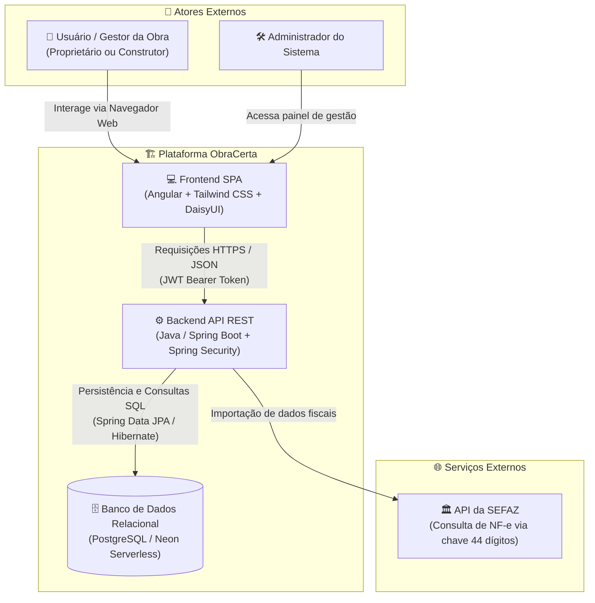
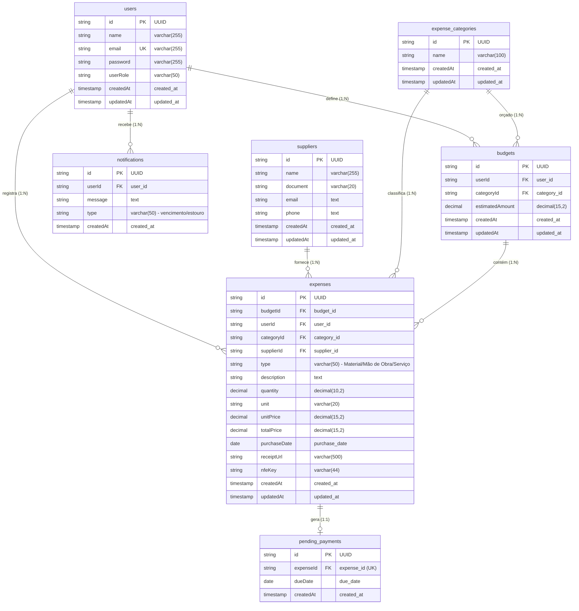

# 📐 Arquitetura do Sistema - ObraCerta!

**Projeto:** ObraCerta (Gestão de Obras Residenciais)  
**Status:** 🟢 Definido (Fase 0 - SDD)  
**Última Atualização:** 2026-09-01

---

## 🏗️ 1. Estrutura do Monorepo

O projeto adota uma arquitetura de **Monorepo**, centralizando a API de serviços, a aplicação client, a documentação e as ordens de serviço (specs) em um único repositório:

```
obra-certa/
├── apps/
│   ├── api/                    # API RESTful em Java (Spring Boot 3)
│   │   ├── src/main/java/com/obracerta/
│   │   │   ├── configuration/  # Configurações de Segurança, CORS e Beans
│   │   │   ├── controller/     # Endpoints REST (Controladores HTTP)
│   │   │   ├── enums/          # Enumerações de Domínio (ex: UserRole)
│   │   │   ├── exception/      # Handler global de exceções e erros padronizados
│   │   │   ├── model/
│   │   │   │   ├── dto/        # Data Transfer Objects (Java Records)
│   │   │   │   └── entity/     # Entidades persistentes JPA (Hibernate)
│   │   │   ├── repository/     # Interfaces de acesso a dados (Spring Data JPA)
│   │   │   └── services/       # Regras de negócio, cálculos e validações
│   │   ├── src/main/resources/ # Configurações de ambiente (application.properties)
│   │   ├── Dockerfile          # Empacotamento do container da API
│   │   └── pom.xml             # Dependências e plugins Maven
│   │
│   └── web/                    # Client SPA em TypeScript (Angular 21)
│       ├── src/app/
│       │   ├── core/           # Singleton Services, Guards e Interceptors HTTP
│       │   │   ├── guards/     # Proteção de rotas autenticadas (authGuard)
│       │   │   ├── interceptors/# Anexação automática do Bearer Token
│       │   │   ├── models/     # Modelos de domínio e interfaces TypeScript
│       │   │   └── services/   # Comunicação com a API (Auth, Budget, Expense)
│       │   ├── shared/         # Componentes e utilitários reutilizáveis
│       │   │   └── components/ # Componentes globais compartilhados (Navbar, Sidebar, etc.)
│       │   └── features/       # Módulos e Componentes de telas (Login, Register, Home)
│       ├── Dockerfile          # Empacotamento do container web (Nginx)
│       └── package.json        # Dependências e scripts do frontend
│
├── docs/                       # Documentação Viva (Docs as Code - Fase 0)
│   ├── prd.md                  # Requisitos, Histórias e Glossário Ubíquo
│   ├── architecture.md         # Estrutura, Modelagem, Padrões e Segurança (este arquivo)
│   ├── user-flows.md           # Jornadas do usuário e pontos de decisão/abandono
│   └── design-tokens.md        # Tokens de design, cores, tipografia e protótipos
│
├── specs/                      # Especificações por Issue (Ciclos de Desenvolvimento)
│   └── README.md               # Índice central de rastreabilidade de specs
│
├── docker-compose.yml          # Orquestração dos serviços (Database, Backend/API, Frontend/Web)
└── README.md                   # Vitrine do projeto, Quick Start e variáveis de ambiente
```

---

## 🌐 2. Diagrama de Contexto do Sistema

O diagrama abaixo ilustra os limites do sistema ObraCerta, os atores que com ele interagem e os sistemas externos com os quais se comunica:



---

## 🗄️ 3. Modelo de Dados (MER Base)

O esquema relacional é gerenciado pelo Hibernate através das entidades JPA. Todas as chaves primárias são geradas como identificadores únicos globais (`UUID`).



---

## 📖 4. Glossário Técnico (Mapeamento PT-BR ➔ EN)

Para eliminar discrepâncias conceituais o código deve aderir estritamente ao mapeamento:

| Conceito de Negócio (PT-BR) | Entidade / Classe Java (EN) | Tabela PostgreSQL    | Coleção / Rota API        |
| :-------------------------- | :-------------------------- | :------------------- | :------------------------ |
| Usuário                     | `User`                      | `users`              | `/api/users`, `/api/auth` |
| Fornecedor                  | `Supplier`                  | `suppliers`          | `/api/suppliers`          |
| Categoria de Despesa        | `ExpenseCategory`           | `expense_categories` | `/api/categories`         |
| Orçamento Inicial           | `Budget`                    | `budgets`            | `/api/budgets`            |
| Despesa                     | `Expense`                   | `expenses`           | `/api/expenses`           |
| Pagamento Pendente          | `PendingPayment`            | `pending_payments`   | `/api/pending-payments`   |
| Notificação / Alerta        | `Notification`              | `notifications`      | `/api/notifications`      |

---

## 🏛️ 5. Padrões Arquiteturais

### 5.1 Backend (Arquitetura em Camadas)

O backend segue a separação estrita de responsabilidades em camadas:

```
[ Requisição HTTP ]
        │
        ▼
[ Controller ] ── (Validação Bean Validation @Valid)
        │
        ▼
  [ Service ]   ── (Regras de Negócio, Cálculo de Totais, Trava RN02)
        │
        ▼
[ Repository ] ── (Spring Data JPA / Hibernate)
        │
        ▼
 [ Banco de Dados PostgreSQL ]
```

**Regras Fundamentais de Isolamento:**

1. **Controllers Magros (Thin Controllers):** Os controladores apenas recebem DTOs de entrada, invocam o serviço correspondente e retornam DTOs de saída com o status HTTP adequado. **É estritamente proibido injetar Repositories em Controllers**.
2. **Lógica nos Services:** Toda verificação de teto, cálculo de porcentagem, regras de negócio e validações de consistência pertencem exclusivamente aos `@Service`.
3. **DTOs Imutáveis com Java Records:** Todas as transferências de dados entre camadas utilizam `record` para assegurar imutabilidade e validação via Bean Validation (`jakarta.validation`).
4. **Entidades JPA Encapsuladas:** Entidades de banco nunca devem ser expostas diretamente nos endpoints da API; sempre são convertidas para DTOs.

### 5.2 Frontend (Angular SPA)

- **Standalone Components:** Uso de componentes independentes sem `NgModule`.
- **Modern Control Flow:** Uso obrigatório da nova sintaxe declarativa `@if`, `@for`, `@switch`.
- **Camada Core:** Serviços singleton (`@Injectable({ providedIn: 'root' })`), `authGuard` para rotas privadas e `authInterceptor` para anexação do token JWT.
- **Camada Features:** Telas organizadas por funcionalidade (`auth/login`, `auth/register`, `home-page`).

---

## 📡 6. Padrão de Comunicação da API

### 6.1 Formato de Resposta de Sucesso

Os endpoints retornam DTOs tipados ou listas diretamente em formato JSON com os códigos HTTP semânticos:

- `200 OK`: Consultas e atualizações bem-sucedidas.
- `201 Created`: Criação de recursos (com cabeçalho `Location` quando aplicável).
- `204 No Content`: Exclusões e operações sem corpo de retorno.

### 6.2 Formato Global de Erro (Tratamento de Exceções)

Toda falha processada pelo `@RestControllerAdvice` global retorna um corpo JSON padronizado e previsível:

```json
{
  "statusCode": 400,
  "timestamp": "2026-09-01T15:30:00.000Z",
  "path": "/api/budgets",
  "message": "O orçamento não pode ser reduzido para um valor menor do que o total já gasto na categoria."
}
```

---

## 🛡️ 7. Segurança e Autenticação

1. **Autenticação Stateless (JWT):**
   - O usuário realiza login em `/api/auth/login` informando e-mail e senha.
   - O backend valida as credenciais via `AuthenticationManager` do Spring Security e emite um token JWT assinado digitalmente com algoritmo HMAC256 (`TokenService`).
   - O frontend armazena o token no `localStorage` do navegador e o anexa a cada requisição HTTP privada no cabeçalho `Authorization: Bearer <token>` via `authInterceptor`.

2. **Criptografia de Senhas:**
   - Senhas são criptografadas com `BCryptPasswordEncoder` antes da persistência no banco.

3. **Controle de Acesso Baseado em Papéis (RBAC):**
   - `ROLE_USER`: Acesso a recursos de seu próprio domínio (despesas, orçamentos, fornecedores).
   - `ROLE_ADMIN`: Acesso irrestrito a gerenciamento de usuários (`/api/users/**`).

4. **Políticas de CORS:**
   - O backend restringe as origens permitidas estritamente ao endereço do frontend (`FRONTEND_URL`), permitindo métodos `GET, POST, PUT, DELETE, OPTIONS`.

---

## ⚙️ 8. Configuração e Variáveis de Ambiente

As configurações sensíveis são injetadas exclusivamente via variáveis de ambiente, garantindo o princípio dos _Twelve-Factor Apps_:

| Variável                     | Finalidade Técnica                                               |
| :--------------------------- | :--------------------------------------------------------------- |
| `SPRING_DATASOURCE_URL`      | String de conexão JDBC com o PostgreSQL / Neon.                  |
| `SPRING_DATASOURCE_USERNAME` | Usuário de conexão do banco de dados.                            |
| `SPRING_DATASOURCE_PASSWORD` | Senha de conexão do banco de dados.                              |
| `JWT_SECRET`                 | Chave criptográfica para assinatura e verificação de tokens JWT. |
| `FRONTEND_URL`               | Origem autorizada no CORS.                                       |
| `SEFAZ_API_KEY`              | Chave de autenticação para o serviço de consulta de NF-e.        |
