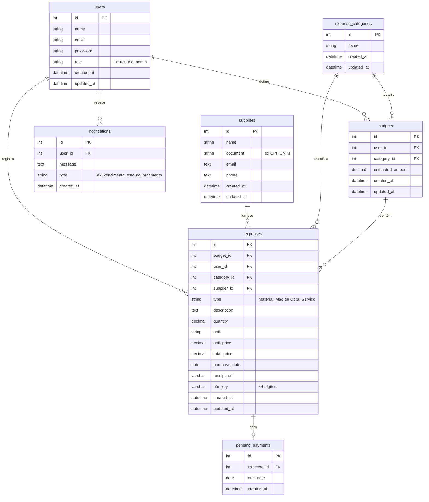

# 📐 Software Design Document (SDD) - ObraCerta!

**Projeto:** ObraCerta (Gestão de Obras Residenciais)  
**Versão:** 1.0.0  
**Status:** 🟢 Pronto para Implementação  
**Stack Principal:** Java 21 (Spring Boot 3), Angular 21, Neon (Serverless Postgres).

---

## 🏗️ 1. Arquitetura do Sistema (Estrutura Monorepo)

O projeto utiliza uma arquitetura de Monorepo para garantir a paridade entre os contratos da API e a interface do usuário. O Agente de IA deve respeitar a seguinte estrutura de pastas:

* **`/backend`**: API REST (Spring Boot + Maven 3.9+). 
* **`/frontend`**: Aplicação Client (Angular 21+). 
* **`/docs`**: Documentação de requisitos e técnica (PRD, SDD).


## 🤖 2. Orquestração e Ecossistema de Contexto (MCP)
> **Instrução para a IA:** Este projeto utiliza o Model Context Protocol (MCP) para garantir que as implementações nunca desviem da especificação. Sempre utilize as ferramentas abaixo antes de propor alterações.

* **GitHub Projects MCP:** Utilize para sincronizar o status das User Stories (PRD) com o desenvolvimento técnico. As definições de "Done" devem seguir os Critérios de Aceitação das Issues.
* **Neon.com MCP:** Interface obrigatória para introspecção e validação do banco de dados PostgreSQL. O esquema gerado pelas classes `@Entity` (JPA/Hibernate) e versionado pelo Flyway deve ser validado contra o estado real do banco via este MCP.
* **SpringDoc OpenAPI:** A especificação Swagger viva servirá como o contrato de verdade para a geração de serviços e modelos no Frontend Angular.

## 📦 3. Stack Tecnológica e Bibliotecas
> Definição estrita das tecnologias permitidas. Nenhuma dependência externa deve ser instalada sem refletir aqui.

### Core & Infraestrutura
* **Ambiente:** Java 21 LTS / Node.js v22.x LTS.
* **Banco de Dados:** PostgreSQL 16 (Hospedado no Neon.com).
* **Backend:** Spring Boot v3.5.4.
* **Frontend:** Angular v21.x (Obrigatório o uso do novo Control Flow `@if`, `@for` e Standalone Components. O uso de `NgModule` está proibido).
* **Persistência:** Spring Data JPA + Hibernate + Flyway (Controle de Migrações).
* **Testes:** JUnit 5, Mockito e Rest-Assured (E2E).

### Bibliotecas e Utilitários Permitidos
* **Segurança:** Spring Security + JWT para autenticação stateless.
* **Documentação:** SpringDoc OpenAPI 3.0 (Swagger UI).
* **Validação:** Hibernate Validator (Bean Validation - `@Valid`).
* **Estilização:** Tailwind CSS v4 + DaisyUI v5 (Configuração CSS-first).
* **Utilitários:** Lombok (Para redução de boilerplate em DTOs/Models) e Jackson (padrão JSON).


## 🗄️ 4. Arquitetura de Dados

### 📖 4.1. Glossário Técnico (Mapeamento)
| Termo PRD (PT-BR) | Entidade Técnica (EN) | Atributos Principais |
| :--- | :--- | :--- |
| Usuário | `users` | `id, name, email, password, role` |
| Categoria | `expense_categories` | `id, name` |
| Orçamento | `budgets` | `id, user_id, category_id, estimated_amount` |
| Fornecedor | `suppliers` | `id, name, email, phone, document` |
| Despesa | `expenses` | `id, budget_id, user_id, category_id, supplier_id, type, description, purchase_date, nfe_key` |
| Pagamento | `pending_payments` | `id, expense_id, due_date` |
| Notificação | `notifications` | `id, user_id, message, type` |


### 🗄️ 4.2. Modelagem de Dados (MER)

> **Instrução para a IA:** Utilize este diagrama Mermaid como fonte da verdade para gerar as entidades JPA e as migrações via Flyway.



## 📑 5. Contratos Globais (DTOs & Interfaces)
> Registros Java (Records) para imutabilidade e validação de entrada/saída.

* **AuthDTO:** `{ email, password }` -> Retorna Token JWT + Perfil.
* **BudgetResponseDTO:** `{ id, workName, totalAmount, totalSpent, percentage }`.
* **NfeImportDTO:** `{ accessKey }` (44 dígitos) -> Retorna dados extraídos do XML.
* **ExpenseCreateDTO:** `{ budgetId, categoryId, supplierId, amount, date, isPaid }`.


## 🏗️ 6. Scaffolding Macro (Arquitetura Backend)

### 📂 6.1. Estrutura de Pacotes (Java Standard Layered)
> **Instrução para a IA:** Utilize a estrutura de camadas clássica do Spring Boot. É proibido criar "Smart Controllers"; toda lógica de negócio deve residir nos Services.

* **`com.obracerta.config`**: Security, Swagger, CORS e Bean Configurations.
* **`com.obracerta.controller`**: Recursos REST com exposição clara via OpenAPI.
* **`com.obracerta.service`**: Lógica de saldo, integração SEFAZ e alertas.
* **`com.obracerta.repository`**: Interfaces Spring Data JPA.
* **`com.obracerta.model`**: Entidades JPA (`@Entity`).
* **`com.obracerta.dto`**: Records para transferência de dados.
* **`com.obracerta.exception`**: Handler global (`@ControllerAdvice`) e exceções customizadas.

### 🧠 6.2. Core Services (Spring Beans)
| Service | Responsabilidade Macro |
| :--- | :--- |
| `AuthService` | Gestão de tokens JWT e criptografia de senhas (BCrypt). |
| `BudgetService` | Cálculo de saldos, porcentagens e validação de teto orçamentário. |
| `NfeService` | Consumo da API da SEFAZ e parseamento de dados fiscais (HU09). |
| `NotificationService` | Disparo de alertas de vencimento e estouro de orçamento. |


## 🛡️ 7. Segurança (API Protection)
> Políticas de acesso rigorosas no nível do servidor.

* **Spring Security:** Filtro JWT global em todas as rotas `/api/**`, exceto `/auth/**`.
* **BCrypt:** Criptografia obrigatória para armazenamento de senhas (RNF04).
* **CORS:** Restrito estritamente à origem do Frontend Angular.
* **Error Handling:** Toda falha deve retornar este formato JSON padronizado:
  ```json
  {
    "statusCode": 400,
    "timestamp": "2026-03-20T23:19:20.000Z",
    "path": "/api/exemplo",
    "message": "Mensagem clara para o usuário (RNF15)"
  }
  ```


## 📡 8. Contratos de API (Endpoints REST)

### 🔐 Módulo de Autenticação
* **POST** `/auth/register` (Novo Usuário)
* **POST** `/auth/login` (Emite JWT)

### 🏗️ Módulo de Gestão de Obras (Budgets)
* **GET** `/api/budgets` (Lista obras do usuário)
* **POST** `/api/budgets` (Define orçamento inicial)
* **DELETE** `/api/budgets/{id}` (Exclui orçamento)
* **GET** `/api/budgets/{id}/dashboard` (Métricas de gastos reais vs. previstos)

### 💸 Módulo de Despesas e NF-e
* **POST** `/api/expenses` (Registro manual)
* **POST** `/api/expenses/import-nfe` (Payload: `{ "key": "string" }`)
* **GET** `/api/expenses` (Lista com filtros por categoria e período)
* **PUT** `/api/expenses/{id}` (Edição completa da despesa)
* **DELETE** `/api/expenses/{id}` (Exclui despesa)

### 🏢 Módulo de Fornecedores (Suppliers)
* **GET** `/api/suppliers` (Lista fornecedores testados globalmente)
* **POST** `/api/suppliers` (Cadastra banco de fornecedor)
* **PUT** `/api/suppliers/{id}` (Edita os dados do fornecedor global)

### 🔔 Módulo de Alertas
* **GET** `/api/notifications` (Lista alertas ativos)
* **PATCH** `/api/notifications/{id}/read` (Marca como visto)


## ⚙️ 9. Contrato de Configuração (Environment)
> **Instrução Crítica:** Utilize arquivos `.env` para desenvolvimento e `application-prod.yml` para produção. Proibido commit de chaves sensíveis.

Variáveis obrigatórias no contrato de ambiente:
* `SPRING_DATASOURCE_URL`: String de conexão Neon (PostgreSQL).
* `JWT_SECRET`: Chave forte para assinatura de tokens.
* `SEFAZ_API_KEY`: Credencial para consulta de NF-e.
* `CORS_ALLOWED_ORIGINS`: Lista de domínios permitidos.
