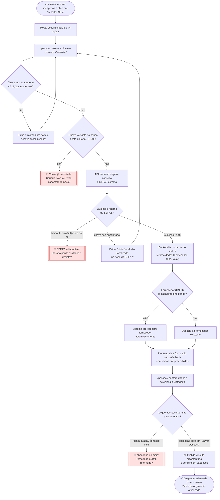
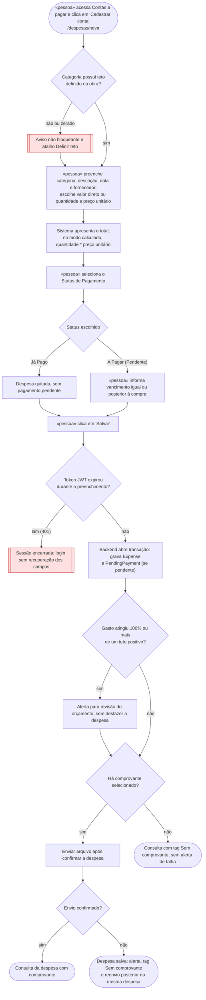
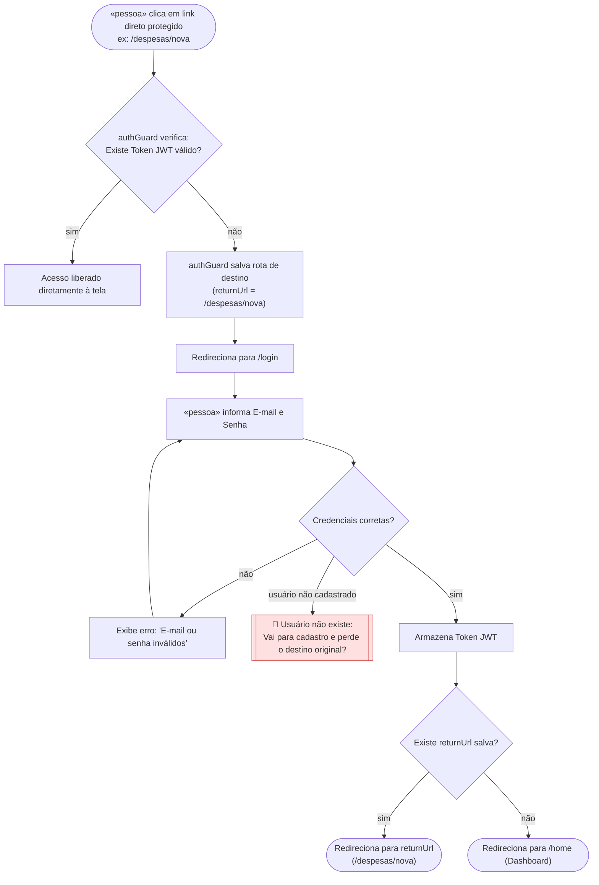

# 🔄 Jornadas do Usuário (User Flows) - ObraCerta!

**Projeto:** ObraCerta (Gestão de Obras Residenciais)  
**Status:** 🟢 Definido (Fase 0 - SDD)  
**Última Atualização:** 2026-09-02  

---

## 🎯 1. Visão Geral

Este documento mapeia o caminho percorrido pelo usuário na interface da aplicação ObraCerta. Mais do que apenas ilustrar o "caminho feliz", o objetivo central é **antecipar pontos de falha, lentidão, abandono e decisões arquiteturais de mitigação**.

### Convenções Adotadas:
- 🔷 **Losango (`{ ... }`):** Decisão automática do sistema (validação, guard, regra de negócio ou verificação de estado).
- 👤 **Retângulo com `«pessoa»` (`[ ... ]`):** Ação direta de interação de quem está na tela.
- 🔴 **Nó Vermelho (`[[ ... ]]` com estilo destacado):** Ponto onde a pessoa trava, a comunicação externa falha ou o fluxo pode ser abandonado.

---

## 🏗️ 2. Jornada 1 (Crítica): Importação de Despesa via Chave de NF-e (SEFAZ)

> **Por que é crítica:** Marca os 4 critérios do SDD: (1) Sai da nossa aplicação para consultar a SEFAZ, (2) Depende do tempo de resposta da API do governo, (3) Depende da validade da chave fiscal e (4) Pode ser abandonada no formulário de conferência.

### 🛡️ Decisões de Projeto para os Nós Vermelhos da Jornada 1:

- **Nó 🔴 X1 (Chave já importada):** Para evitar frustração ou tentativas repetidas, o sistema realiza a checagem de duplicidade no banco local **antes** de enviar a requisição à SEFAZ. Caso a chave já exista, o modal bloqueia o reenvio e apresenta imediatamente um alerta amigável com botão de ação direta: `[Ver Despesa Existente]`, redirecionando o usuário para o registro original já salvo.
- **Nó 🔴 X2 (SEFAZ indisponível / Timeout):** O backend possui timeout estrito de 5 segundos para a chamada externa. Em caso de indisponibilidade da SEFAZ, a interface não trava: exibe o alerta *"Servidor da SEFAZ temporariamente indisponível"* e oferece um botão alternativo: `[Continuar com Cadastro Manual]`. Ao clicar, o formulário de despesas é aberto com a chave de 44 dígitos já preenchida no campo `nfeKey`, permitindo ao usuário digitar o valor sem perder a referência fiscal.
- **Nó 🔴 X3 (Abandono no meio da conferência):** Assim que o backend devolve o payload extraído da NF-e, o frontend armazena temporariamente os dados em `sessionStorage`. Se o usuário recarregar a página acidentalmente ou fechar a aba, ao reabrir a tela de despesas um aviso discreto surge no topo: *"Você tem uma nota fiscal aguardando conferência. Deseja restaurar?"*, evitando ter que redigitar a chave ou reprocessar na SEFAZ.

---

## 💰 3. Jornada 2 (Crítica): Lançamento de Despesa, Alerta de Orçamento e Conta a Pagar

> **Por que é crítica:** Envolve cálculo dinâmico de teto financeiro (RN02), alertas preventivos de estouro de gastos e geração de obrigações financeiras futuras (`PendingPayment`).

### 🛡️ Decisões de Projeto para os Nós Vermelhos da Jornada 2:

- **Nó 🔴 X1 (Regra na porta - Sem orçamento cadastrado):** Aplicando a diretriz do SDD de checagem na porta (e não na saída após preencher tudo), se o usuário não tiver nenhum orçamento configurado, a interface não bloqueia agressivamente com erro 400. Ela apresenta um banner superior explicativo: *"Você ainda não definiu um teto para esta categoria. [Definir Orçamento Agora]"*. A despesa pode ser salva como custo avulso, garantindo que o usuário nunca seja impedido de registrar um gasto real imediato.
- **Nó 🔴 X2 (Sessão expirada durante o formulário):** Na entrega da US03 até a tarefa 8, `authInterceptor` encerra a sessão ao receber `401` e direciona ao login. Não há recuperação dos campos nem reenvio automático. Idempotência da criação e restauração após login foram retiradas pelo autor em 2026-10-30; uma resposta de criação perdida não garante ausência de gravação nem repetição sem duplicação.

---

## 🔐 4. Jornada 3: Autenticação, Proteção de Rotas e Retenção de Contexto

> **Por que é crítica:** Evita o problema clássico de perda de contexto e telas travadas durante a navegação.

### 🛡️ Decisões de Projeto para o Nó Vermelho da Jornada 3:

- **Nó 🔴 X1 (Usuário não cadastrado e perda de destino):** Ao clicar em *"Criar Conta"* a partir da tela de login, o parâmetro `?returnUrl=/despesas/nova` é propagado para a rota `/register`. Após concluir o cadastro com sucesso e realizar o primeiro login, o sistema recupera o parâmetro e entrega o usuário exatamente na tela onde ele queria chegar inicialmente, garantindo uma experiência contínua e sem atritos.
